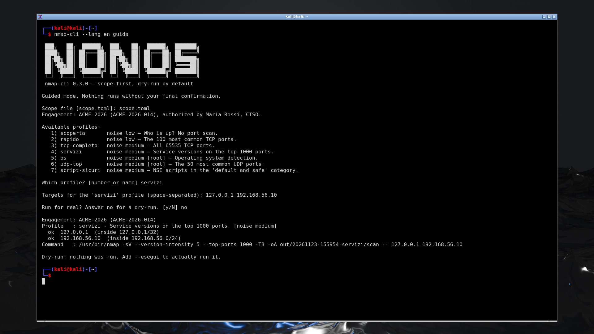
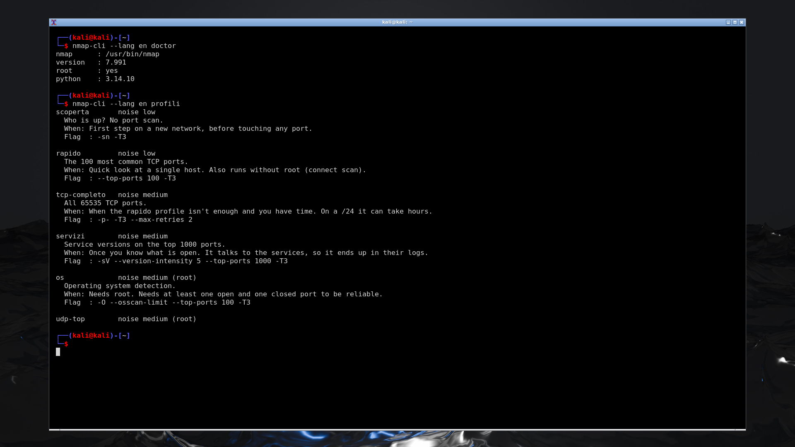

# nmap-cli

🌐 [Italiano](README.md) · **English** · [中文](README.zh.md)

[](https://github.com/NON-OS/nmap-cli/actions/workflows/ci.yml)


```
  ┌─ scope ─┐   ┌─ dry-run ─┐   ┌─ confirm ──┐   ┌─ nmap ─┐   ┌─ audit ─┐   ┌─ report ───┐
  │ check   │ → │ show      │ → │ reference  │ → │ runs   │ → │ chain   │ → │ XML → md   │
  └─────────┘   └───────────┘   └────────────┘   └────────┘   └─────────┘   └────────────┘
```

An Nmap wrapper with scope validation, dry-run by default, and a Docker lab for testing against legal targets.

> **Your own systems, or with written authorization only.** Read [DISCLAIMER.md](DISCLAIMER.md) before running anything.

## What it is

`nmap-cli` is a thin orchestrator around Nmap. It does not replace Nmap and does not reimplement its scanning logic. Its job is to stop a scan from firing at the wrong target, to keep a record of what was run, and to turn the results into something you can hand over.

The problem it solves is simple: Nmap is powerful, and an `-sS` aimed at the wrong IP can cost a contract, an account, or worse. Nmap's own documentation is explicit about it: "obtaining permission first is the best approach," and administrators "tend to be more cooperative when asked in advance rather than woken at 3:00 a.m. by an IDS alarm." This wrapper reads a scope file, validates the target, and runs nothing without an explicit flag. If the target is not in scope, the command exits with code 3 and nothing runs.

## In action



*Guided mode (`nmap-cli guida`) on Kali Linux: logo, profile choice, scope validation, command preview. Real screenshot.*

A target inside scope, in dry-run (the default behavior):

```console
$ nmap-cli scansiona rapido 192.168.56.10 --scope scope.toml
Engagement: ACME-rete-interna (ACME-2026-014)
Profile   : rapido - The 100 most common TCP ports. [noise low]
  ok  192.168.56.10  (inside 192.168.56.10/32)
Command   : /usr/bin/nmap --top-ports 100 -T3 -oA out/20261122-230615-rapido/scan -- 192.168.56.10

Dry-run: nothing was run. Add --esegui to actually run it.
```

A target out of scope, even among valid ones:

```console
$ nmap-cli scansiona rapido 192.168.56.10 1.1.1.1 --scope scope.toml
nmap-cli: targets out of scope, running nothing:
  1.1.1.1: not contained in any included network
$ echo $?
3
```

After the scan, the report and the diff against yesterday's:

```console
$ nmap-cli rapporto out/20261122-230615-servizi/scan.xml
192.168.56.10  srv.lab
  22/tcp     ssh            OpenSSH 9.6
  443/tcp    https          nginx 1.25

$ nmap-cli confronta ieri/scan.xml oggi/scan.xml
+ port opened    192.168.56.10 8443/tcp
~ version        192.168.56.10 22/tcp: OpenSSH 9.2 -> OpenSSH 9.6
```

## What it does

| | |
|---|---|
| Scope | IP, CIDR, hostname, wildcard, exclusions, validity dates. When in doubt it refuses. |
| Dry-run | By default nothing runs. `--esegui` asks for confirmation. |
| Profiles | Seven, cautious, each with a noise level and when to use it. |
| Flag filter | `-iL`, `-sI`, `-D`, `-oX` and the like are blocked, including the attached form. |
| Signed scope | The client signs the scope with an SSH key. If the file changes after signing, nothing runs. |
| Audit | A hash-chained log. A modified line shows. Scope hash and signer included. |
| Report | From the XML to text, Markdown or JSON. |
| Diff | What changed between two scans, with an exit code for CI. |
| Dependencies | None: Python standard library only. |

## Platform

Built for **Kali**, **Parrot**, and Linux in general: that is where nmap lives and where `nmap-cli` is used on a real engagement. It also runs on macOS. Windows is untested, and there some privilege checks (`os.geteuid`) do not apply.

## Installation

You need Python 3.11 or newer and Nmap 7.90 or newer.

Nmap: on Kali it is already installed (`sudo apt install nmap` to update it); on Debian/Ubuntu `sudo apt install nmap`; on macOS `brew install nmap`.

```sh
git clone git@github.com:NON-OS/nmap-cli.git
cd nmap-cli
python3 -m venv .venv && . .venv/bin/activate
pip install -e .
nmap-cli doctor
```

## Language

This README comes in three languages: [Italiano](README.md), English (this one), [中文](README.zh.md). Use the links at the top to switch.

Everything the tool prints follows the chosen language: prompts, the guided mode, scope reasons, errors, reports, diffs and `--help`. Pick it with `--lang it|en|zh`, or set `NONOS_LANG` once for the whole system. The system locale is ignored on purpose: without either of the two, the tool starts in Italian. Command and profile names never change.

```sh
nmap-cli --lang en guida
NONOS_LANG=zh nmap-cli doctor
```

## First use

### The simplest way: guided mode

`nmap-cli guida` asks you one question at a time (scope, profile, target), shows the command preview, and runs nothing without your final confirmation. It is the recommended way to start:

```sh
nmap-cli guida
```

### Or by command

```sh
nmap-cli init scope.toml          # create the template
$EDITOR scope.toml                # fill it in with the client
nmap-cli verifica 192.168.56.10 --scope scope.toml
nmap-cli scansiona rapido 192.168.56.10 --scope scope.toml            # dry-run
nmap-cli scansiona rapido 192.168.56.10 --scope scope.toml --esegui   # actually runs
```

In a terminal `--esegui` asks you to type the engagement reference. In a script use `--conferma`. Other Nmap flags go after `--`, as long as they are not among the forbidden ones ([docs/04-profili.md](docs/en/04-profili.md)).

## Commands

| Command | What it does |
|---|---|
| `guida` | interactive step by step: scope → profile → target → confirm |
| `scansiona <profile> <target...>` | validate and build (or run) the scan |
| `verifica <target...>` | says whether targets are in scope, without scanning |
| `scope-firma <file>` / `scope-verifica <file>` | sign and check the scope with an SSH key |
| `rapporto <scan.xml>` | report in text, Markdown or JSON |
| `confronta <old.xml> <new.xml>` | differences between two scans |
| `profili` | lists the profiles with their exact flags |
| `audit [file]` | verifies the log chain |
| `init [file]` | creates a scope file to fill in |
| `doctor` | checks nmap, version, privileges |

The subcommand names stay the same in every language; only the messages are translated.

## Profiles

| Profile | What it does | Root | Noise |
|---|---|---|---|
| `scoperta` | live hosts, no ports | no | low |
| `rapido` | top 100 TCP ports | no | low |
| `tcp-completo` | all 65535 TCP ports | no | medium |
| `servizi` | service versions, 1000 ports | no | medium |
| `os` | operating system detection | yes | medium |
| `udp-top` | top 50 UDP ports | yes | medium |
| `script-sicuri` | NSE `default and safe` | no | medium |



*`nmap-cli doctor` (finds the real nmap binary in `/usr/bin/`) and the profile list, on Kali Linux.*

## Exit codes

| Code | Meaning |
|---|---|
| 0 | all good |
| 2 | bad arguments or forbidden flag |
| 3 | at least one target out of scope |
| 4 | scope unreadable, malformed or expired |
| 5 | nmap missing or too old |
| 6 | run without confirmation, or a profile that needs root without sudo |
| 7 | nmap exited with an error, or the audit chain is broken |

## Documentation

1. [Introduction and philosophy](docs/en/01-introduzione.md)
2. [Authorization: what you need before touching a target](docs/en/02-autorizzazione.md)
3. [The scope file](docs/en/03-scope.md)
4. [Profiles and forbidden flags](docs/en/04-profili.md)
5. [The audit log](docs/en/05-audit.md)
6. [Architecture](docs/en/06-architettura.md)
7. [The lab for safe testing](docs/en/07-lab.md)
8. [Reports and diffs](docs/en/08-rapporti.md)
9. [Signed scope](docs/en/09-firma.md)
10. [Compatibility and testing](docs/en/10-compatibilita.md)
11. [Why it doesn't do brute force](docs/en/11-brute-force.md)

The shell cheatsheet the project grew out of is in [scripts/](scripts/).

## What it does not do

It does not discover whether you have permission: you declare it in the scope file, and the program believes you. It does not protect against someone running `nmap` directly. The flag filter is a safety net against mistakes, not a sandbox. The details are in [docs/06-architettura.md](docs/en/06-architettura.md). It does not automate credential brute force, on purpose: [docs/11-brute-force.md](docs/en/11-brute-force.md) explains why and how to do it by hand.

## Development

```sh
make check     # ruff (lint + format), mypy --strict, tests and coverage
```

No runtime dependencies (standard library only). Development tools install with `pip install -e ".[dev]"`. See [CONTRIBUTING.md](CONTRIBUTING.md) and [SECURITY.md](SECURITY.md).

## License

MIT, see [LICENSE](LICENSE). The license covers the code, it does not authorize any scan.
