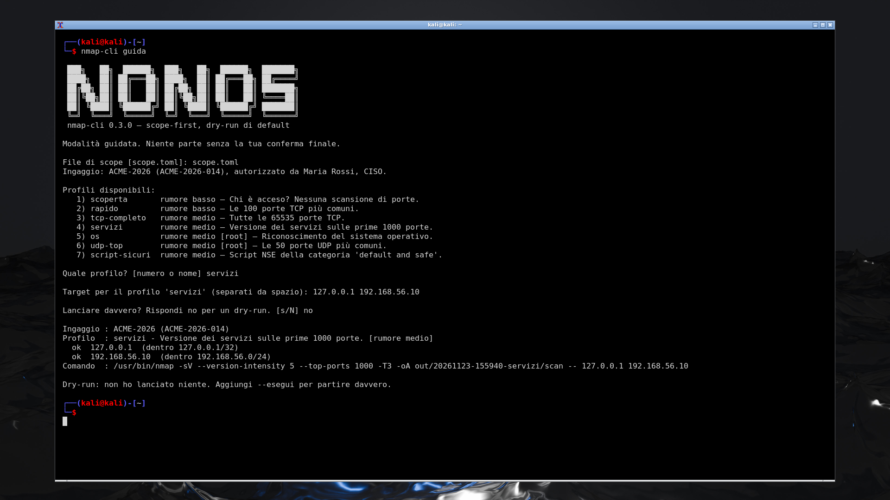
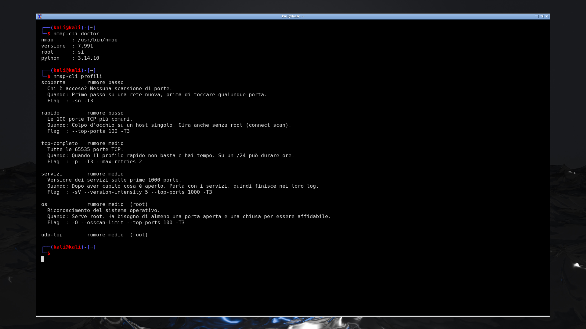

# nmap-cli

🌐 **Italiano** · [English](README.en.md) · [中文](README.zh.md)

[](https://github.com/NON-OS/nmap-cli/actions/workflows/ci.yml)


```
  ┌─ scope ─┐   ┌─ dry-run ─┐   ┌─ conferma ─┐   ┌─ nmap ─┐   ┌─ audit ─┐   ┌─ rapporto ─┐
  │ valida  │ → │ mostra    │ → │ riferimento│ → │ parte  │ → │ catena  │ → │ XML → md   │
  └─────────┘   └───────────┘   └────────────┘   └────────┘   └─────────┘   └────────────┘
```

Un wrapper Nmap con validazione dello scope, dry-run di default, e un lab Docker per test su target legali.

> **Solo sistemi tuoi o con autorizzazione scritta.** Leggi [DISCLAIMER.md](DISCLAIMER.md) prima di lanciare qualsiasi cosa.

## Cos'è

`nmap-cli` è un orchestratore sottile attorno a Nmap. Non sostituisce Nmap e non ne reimplementa la logica di scansione. Il suo scopo è impedire che una scansione parta sul target sbagliato, tenere traccia di cosa è stato lanciato, e trasformare i risultati in qualcosa che si può consegnare.

Il problema che risolve è semplice: Nmap è potente, e un `-sS` lanciato sull'IP sbagliato può costare un contratto, un account, o peggio. La documentazione ufficiale di Nmap è esplicita sul punto: "ottenere prima il permesso è l'approccio migliore", e "gli amministratori tendono a essere più collaborativi quando vengono interpellati in anticipo piuttosto che svegliati alle 3:00 di notte da un allarme IDS". Questo wrapper legge uno scope file, valida il target, e non esegue nulla senza un flag esplicito. Se il target non è nello scope, il comando esce con codice 3 e non parte niente.

## In azione



*Modalità guidata (`nmap-cli guida`) eseguita su Kali Linux: logo, scelta del profilo, validazione dello scope, anteprima del comando. Screenshot reale.*

Un target dentro lo scope, in dry-run (il comportamento normale):

```console
$ nmap-cli scansiona rapido 192.168.56.10 --scope scope.toml
Ingaggio : ACME-rete-interna (ACME-2026-014)
Profilo  : rapido - Le 100 porte TCP più comuni. [rumore basso]
  ok  192.168.56.10  (dentro 192.168.56.10/32)
Comando  : /usr/bin/nmap --top-ports 100 -T3 -oA out/20261122-230615-rapido/scan -- 192.168.56.10

Dry-run: non ho lanciato niente. Aggiungi --esegui per partire davvero.
```

Un target fuori scope, anche in mezzo a target validi:

```console
$ nmap-cli scansiona rapido 192.168.56.10 1.1.1.1 --scope scope.toml
nmap-cli: target fuori scope, non eseguo nulla:
  1.1.1.1: non è contenuto in nessuna rete inclusa
$ echo $?
3
```

Dopo la scansione, il rapporto e il confronto con quella di ieri:

```console
$ nmap-cli rapporto out/20261122-230615-servizi/scan.xml
192.168.56.10  srv.lab
  22/tcp     ssh            OpenSSH 9.6
  443/tcp    https          nginx 1.25

$ nmap-cli confronta ieri/scan.xml oggi/scan.xml
+ porta aperta   192.168.56.10 8443/tcp
~ versione       192.168.56.10 22/tcp: OpenSSH 9.2 -> OpenSSH 9.6
```

## Cosa fa

| | |
|---|---|
| Scope | IP, CIDR, hostname, wildcard, esclusioni, date di validità. Nel dubbio rifiuta. |
| Dry-run | Di default non parte niente. `--esegui` chiede conferma. |
| Profili | Sette, prudenti, con indicazione di rumore e di quando usarli. |
| Filtro flag | `-iL`, `-sI`, `-D`, `-oX` e simili sono bloccati, anche nella forma attaccata. |
| Scope firmato | Il cliente firma lo scope con la sua chiave SSH. Se il file cambia dopo la firma, non parte niente. |
| Audit | Registro a catena di hash. Una riga modificata si vede. Hash dello scope e firmatario inclusi. |
| Rapporto | Dall'XML a testo, Markdown o JSON. |
| Confronto | Cosa è cambiato tra due scansioni, con codice di uscita per la CI. |
| Dipendenze | Nessuna: solo la libreria standard di Python. |

## Piattaforma

Pensato per **Kali**, **Parrot** e Linux in generale: è lì che nmap vive e dove `nmap-cli` viene usato in un ingaggio reale. Gira anche su macOS. Windows non è provato, e lì alcuni controlli sui privilegi (`os.geteuid`) non valgono.

## Installazione

Serve Python 3.11 o più recente e Nmap 7.90 o più recente.

Nmap: su Kali è già installato (`sudo apt install nmap` per aggiornarlo); su Debian/Ubuntu `sudo apt install nmap`; su macOS `brew install nmap`.

```sh
git clone git@github.com:NON-OS/nmap-cli.git
cd nmap-cli
python3 -m venv .venv && . .venv/bin/activate
pip install -e .
nmap-cli doctor
```

## Lingua

Tutto quello che il programma stampa segue la lingua scelta: domande, modalità guidata, motivi dello scope, errori, rapporti, confronti e `--help`. Si sceglie con `--lang it|en|zh`, oppure una volta per tutto il sistema con `NONOS_LANG`. Il locale di sistema è ignorato di proposito: senza nessuno dei due si parte sempre in italiano. I nomi dei comandi e dei profili non cambiano mai.

```sh
nmap-cli --lang en guida
NONOS_LANG=zh nmap-cli doctor
```

## Primo uso

### Il modo più semplice: modalità guidata

`nmap-cli guida` ti fa le domande una alla volta — scope, profilo, target — mostra l'anteprima del comando e non lancia niente senza la tua conferma finale. È il modo consigliato per iniziare:

```sh
nmap-cli guida
```

### Oppure a comandi

```sh
nmap-cli init scope.toml          # crea il modello
$EDITOR scope.toml                # compilalo con il cliente
nmap-cli verifica 192.168.56.10 --scope scope.toml
nmap-cli scansiona rapido 192.168.56.10 --scope scope.toml            # dry-run
nmap-cli scansiona rapido 192.168.56.10 --scope scope.toml --esegui   # parte davvero
```

In un terminale `--esegui` ti chiede di scrivere il riferimento dell'ingaggio. In uno script usa `--conferma`. Altri flag di Nmap si passano dopo `--`, se non sono tra i vietati ([docs/04-profili.md](docs/04-profili.md)).

## Comandi

| Comando | Cosa fa |
|---|---|
| `guida` | modalità interattiva passo per passo: scope → profilo → target → conferma |
| `scansiona <profilo> <target...>` | valida e costruisce (o lancia) la scansione |
| `verifica <target...>` | dice se i target sono nello scope, senza scansionare |
| `scope-firma <file>` / `scope-verifica <file>` | firma e controlla lo scope con una chiave SSH |
| `rapporto <scan.xml>` | report in testo, Markdown o JSON |
| `confronta <vecchia.xml> <nuova.xml>` | differenze tra due scansioni |
| `profili` | elenca i profili con i flag esatti |
| `audit [file]` | verifica la catena del registro |
| `init [file]` | crea un file di scope da compilare |
| `doctor` | controlla nmap, versione, privilegi |

## Profili

| Profilo | Cosa fa | Root | Rumore |
|---|---|---|---|
| `scoperta` | host attivi, niente porte | no | basso |
| `rapido` | 100 porte TCP più comuni | no | basso |
| `tcp-completo` | tutte le 65535 porte TCP | no | medio |
| `servizi` | versioni dei servizi, 1000 porte | no | medio |
| `os` | riconoscimento del sistema operativo | sì | medio |
| `udp-top` | 50 porte UDP più comuni | sì | medio |
| `script-sicuri` | NSE `default and safe` | no | medio |



*`nmap-cli doctor` (trova il binario reale di nmap in `/usr/bin/`) e l'elenco dei profili, su Kali Linux.*

## Codici di uscita

| Codice | Significato |
|---|---|
| 0 | tutto a posto |
| 2 | argomenti sbagliati o flag vietato |
| 3 | almeno un target fuori scope |
| 4 | scope illeggibile, malformato o scaduto |
| 5 | nmap assente o troppo vecchio |
| 6 | esecuzione senza conferma, o profilo che richiede root senza sudo |
| 7 | nmap è uscito con errore, o la catena di audit è spezzata |

## Documentazione

1. [Introduzione e filosofia](docs/01-introduzione.md)
2. [Autorizzazione: cosa serve prima di toccare un target](docs/02-autorizzazione.md)
3. [Il file di scope](docs/03-scope.md)
4. [Profili e flag vietati](docs/04-profili.md)
5. [Il registro di audit](docs/05-audit.md)
6. [Architettura](docs/06-architettura.md)
7. [Il lab per testare in sicurezza](docs/07-lab.md)
8. [Rapporti e confronti](docs/08-rapporti.md)
9. [Scope firmato](docs/09-firma.md)
10. [Compatibilità e prove](docs/10-compatibilita.md)
11. [Perché non fa brute force](docs/11-brute-force.md)

Il cheatsheet shell da cui è nato il progetto è in [scripts/](scripts/).

## Cosa non fa

Non scopre se hai il permesso: lo dichiari tu nel file di scope, e il programma ti crede. Non protegge da chi lancia `nmap` direttamente. Il filtro sui flag è una rete di sicurezza contro gli errori, non una sandbox. I dettagli sono in [docs/06-architettura.md](docs/06-architettura.md). Non automatizza il brute force sulle credenziali, di proposito: [docs/11-brute-force.md](docs/11-brute-force.md) spiega perché e come farlo a mano.

## Sviluppo

```sh
make check     # ruff (lint + format), mypy --strict, test e coverage
```

Nessuna dipendenza a runtime (solo la libreria standard). Gli strumenti di sviluppo si installano con `pip install -e ".[dev]"`. Vedi [CONTRIBUTING.md](CONTRIBUTING.md) e [SECURITY.md](SECURITY.md).

## Licenza

MIT, vedi [LICENSE](LICENSE). La licenza copre il codice, non autorizza nessuna scansione.
