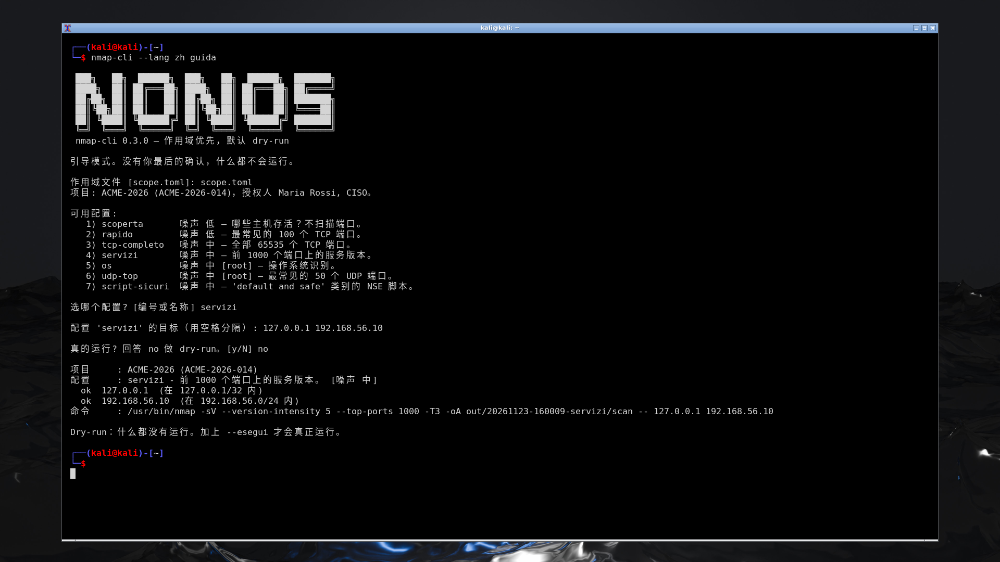
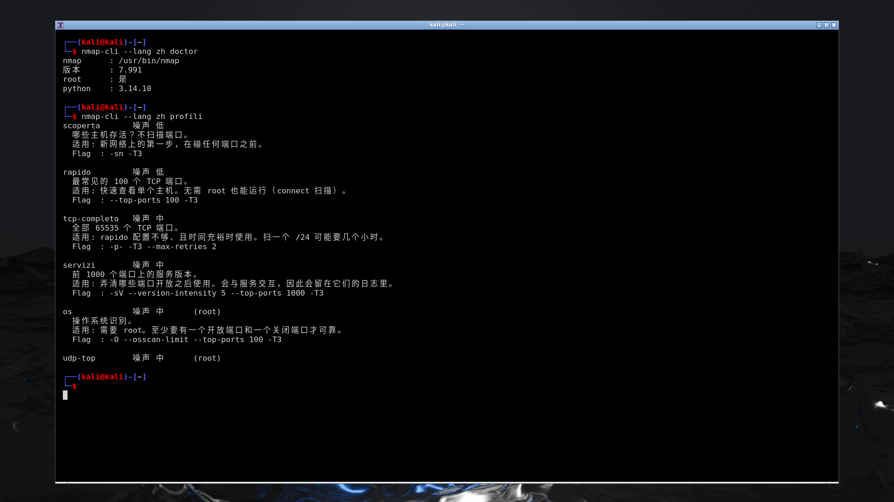

# nmap-cli

🌐 [Italiano](README.md) · [English](README.en.md) · **中文**

> ⚠️ 本页为机器翻译草稿，正式发布前需母语者校对（尤其是关于授权与法律的措辞）。

[](https://github.com/NON-OS/nmap-cli/actions/workflows/ci.yml)


```
  ┌─ scope ─┐   ┌─ dry-run ─┐   ┌─ confirm ──┐   ┌─ nmap ─┐   ┌─ audit ─┐   ┌─ report ───┐
  │ 校验    │ → │ 显示      │ → │ 工单编号   │ → │ 运行   │ → │ 哈希链  │ → │ XML → md   │
  └─────────┘   └───────────┘   └────────────┘   └────────┘   └─────────┘   └────────────┘
```

Nmap 的封装工具：带作用域校验、默认 dry-run，以及一个用于在合法目标上测试的 Docker 实验环境。

> **只能用于你自己的系统，或有书面授权的系统。** 运行任何命令前请先阅读 [DISCLAIMER.md](DISCLAIMER.md)。

## 这是什么

`nmap-cli` 是 Nmap 外面的一层很薄的编排工具。它不替代 Nmap，也不重新实现扫描逻辑。它的作用是：防止扫描打到错误的目标、记录运行过的内容、把结果整理成可以交付的形式。

它要解决的问题很简单：Nmap 很强，一条打错 IP 的 `-sS` 可能让你丢掉一份合同、一个账号，甚至更糟。Nmap 官方文档说得很直白：“先取得许可是最好的做法”，管理员“被提前征询时往往更配合，而不是凌晨三点被 IDS 警报叫醒”。这个封装会读取一个作用域文件、校验目标，没有明确的标志就什么都不运行。如果目标不在作用域内，命令以退出码 3 结束，什么都不会运行。

## 实际效果



*在 Kali Linux 上的引导模式（`nmap-cli guida`）：logo、选择配置、作用域校验、命令预览。真实截图。*

一个在作用域内的目标，dry-run（默认行为）：

```console
$ nmap-cli scansiona rapido 192.168.56.10 --scope scope.toml
项目     : ACME-rete-interna (ACME-2026-014)
配置     : rapido - 最常见的 100 个 TCP 端口。 [噪声 低]
  ok  192.168.56.10  (在 192.168.56.10/32 内)
命令     : /usr/bin/nmap --top-ports 100 -T3 -oA out/20261122-230615-rapido/scan -- 192.168.56.10

Dry-run：什么都没有运行。加上 --esegui 才会真正运行。
```

一个在作用域外的目标，即使和合法目标混在一起：

```console
$ nmap-cli scansiona rapido 192.168.56.10 1.1.1.1 --scope scope.toml
nmap-cli: 目标超出作用域，不运行任何东西：
  1.1.1.1: 不在任何已包含的网络内
$ echo $?
3
```

## 功能一览

| | |
|---|---|
| 作用域 | IP、CIDR、主机名、通配符、排除项、有效期。拿不准就拒绝。 |
| Dry-run | 默认什么都不运行。`--esegui` 会要求确认。 |
| 配置 | 七个，偏保守，各自标注噪声级别和适用场景。 |
| 标志过滤 | `-iL`、`-sI`、`-D`、`-oX` 等被拦截，连紧跟值的写法也拦。 |
| 签名作用域 | 客户用 SSH 密钥对作用域签名。文件签名后被改动，就什么都不运行。 |
| 审计 | 哈希链日志。被改过的行一看便知。包含作用域哈希和签名者。 |
| 报告 | 从 XML 转为文本、Markdown 或 JSON。 |
| 对比 | 两次扫描之间的变化，带可用于 CI 的退出码。 |
| 依赖 | 无：仅用 Python 标准库。 |

## 平台

为 **Kali**、**Parrot** 以及 Linux 而设计：nmap 就生活在那里，`nmap-cli` 也在真实的渗透项目中在那里使用。它也能在 macOS 上运行。Windows 未经测试，在那里部分权限检查（`os.geteuid`）不适用。

## 安装

需要 Python 3.11 或更新版本，以及 Nmap 7.90 或更新版本。

Nmap：Kali 上已预装（`sudo apt install nmap` 用于更新）；Debian/Ubuntu 上 `sudo apt install nmap`；macOS 上 `brew install nmap`。

```sh
git clone git@github.com:NON-OS/nmap-cli.git
cd nmap-cli
python3 -m venv .venv && . .venv/bin/activate
pip install -e .
nmap-cli doctor
```

## 语言

本 README 提供三种语言：[Italiano](README.md)、[English](README.en.md)、中文（本文件）。用顶部的链接切换。

工具打印的所有内容都跟随所选语言：提示、引导模式、作用域原因、报错、报告、对比以及 `--help`。用 `--lang it|en|zh` 选择，或者设置一次 `NONOS_LANG`，对整个系统生效。系统区域设置会被刻意忽略：两者都没有时，工具总是从意大利语开始。命令名和配置名永远不变。

```sh
nmap-cli --lang zh guida
NONOS_LANG=zh nmap-cli doctor
```

## 第一次使用

### 最简单的方式：引导模式

`nmap-cli guida` 会一次问你一个问题（作用域、配置、目标），显示命令预览，没有你最后的确认就什么都不运行。推荐从这里开始：

```sh
nmap-cli guida
```

### 或者用命令

```sh
nmap-cli init scope.toml          # 生成模板
$EDITOR scope.toml                # 和客户一起填好
nmap-cli verifica 192.168.56.10 --scope scope.toml
nmap-cli scansiona rapido 192.168.56.10 --scope scope.toml            # dry-run
nmap-cli scansiona rapido 192.168.56.10 --scope scope.toml --esegui   # 真正运行
```

在终端里 `--esegui` 会要求你输入项目工单编号。在脚本里用 `--conferma`。其他 Nmap 标志写在 `--` 之后，只要不在被禁用之列（[docs/04-profili.md](docs/zh/04-profili.md)）。

## 命令

| 命令 | 作用 |
|---|---|
| `guida` | 交互式一步步进行：作用域 → 配置 → 目标 → 确认 |
| `scansiona <配置> <目标...>` | 校验并构建（或运行）扫描 |
| `verifica <目标...>` | 判断目标是否在作用域内，不扫描 |
| `scope-firma <文件>` / `scope-verifica <文件>` | 用 SSH 密钥对作用域签名和校验 |
| `rapporto <scan.xml>` | 文本、Markdown 或 JSON 报告 |
| `confronta <旧.xml> <新.xml>` | 两次扫描的差异 |
| `profili` | 列出各配置及其确切标志 |
| `audit [文件]` | 校验日志链 |
| `init [文件]` | 生成待填写的作用域文件 |
| `doctor` | 检查 nmap、版本、权限 |

子命令名在各语言中保持不变，只有提示信息被翻译。

## 配置

| 配置 | 作用 | Root | 噪声 |
|---|---|---|---|
| `scoperta` | 存活主机，不扫端口 | 否 | 低 |
| `rapido` | 前 100 个 TCP 端口 | 否 | 低 |
| `tcp-completo` | 全部 65535 个 TCP 端口 | 否 | 中 |
| `servizi` | 服务版本，1000 端口 | 否 | 中 |
| `os` | 操作系统识别 | 是 | 中 |
| `udp-top` | 前 50 个 UDP 端口 | 是 | 中 |
| `script-sicuri` | NSE `default and safe` | 否 | 中 |



*`nmap-cli doctor`（在 `/usr/bin/` 找到真实的 nmap 二进制）和配置列表，在 Kali Linux 上。*

## 退出码

| 码 | 含义 |
|---|---|
| 0 | 一切正常 |
| 2 | 参数错误或使用了被禁标志 |
| 3 | 至少有一个目标在作用域外 |
| 4 | 作用域不可读、格式错误或已过期 |
| 5 | nmap 缺失或过旧 |
| 6 | 未确认就运行，或某配置需要 root 却没有 sudo |
| 7 | nmap 以错误退出，或审计链断裂 |

## 文档

1. [介绍与理念](docs/zh/01-introduzione.md)
2. [授权：接触目标之前需要什么](docs/zh/02-autorizzazione.md)
3. [作用域文件](docs/zh/03-scope.md)
4. [配置与被禁标志](docs/zh/04-profili.md)
5. [审计日志](docs/zh/05-audit.md)
6. [架构](docs/zh/06-architettura.md)
7. [用于安全测试的实验环境](docs/zh/07-lab.md)
8. [报告与对比](docs/zh/08-rapporti.md)
9. [签名作用域](docs/zh/09-firma.md)
10. [兼容性与测试](docs/zh/10-compatibilita.md)
11. [为什么不做暴力破解](docs/zh/11-brute-force.md)

项目最初源自的 shell 速查表在 [scripts/](scripts/)。

## 它不做什么

它不判断你是否有权限：你在作用域文件里声明，程序就信你。它拦不住直接运行 `nmap` 的人。标志过滤是防止失误的安全网，不是沙箱。细节见 [docs/06-architettura.md](docs/zh/06-architettura.md)。 它刻意不自动化凭据暴力破解：[docs/11-brute-force.md](docs/zh/11-brute-force.md) 解释了原因以及如何手工操作。

## 开发

```sh
make check     # ruff（lint + format）、mypy --strict、测试与覆盖率
```

无运行时依赖（仅标准库）。开发工具用 `pip install -e ".[dev]"` 安装。见 [CONTRIBUTING.md](CONTRIBUTING.md) 与 [SECURITY.md](SECURITY.md)。

## 许可

MIT，见 [LICENSE](LICENSE)。许可覆盖代码，不授权任何扫描。
