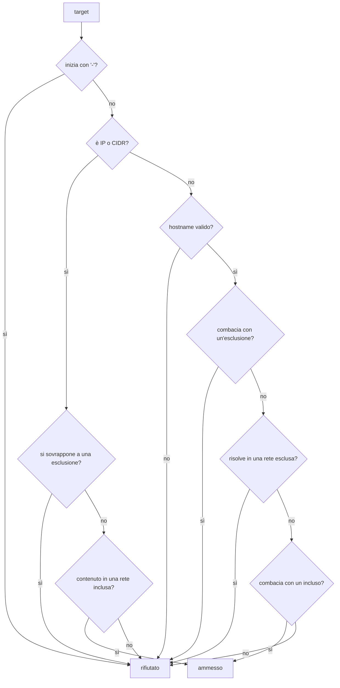

# Il file di scope

🌐 **Italiano** · [English](en/03-scope.md) · [中文](zh/03-scope.md)

Lo scope è un file TOML con due sezioni. `nmap-cli init` ne crea uno da compilare.

```toml
[engagement]
nome = "ACME-rete-interna"
autorizzato_da = "Maria Rossi, CISO, Acme S.p.A."
riferimento = "ACME-2026-014"
valido_dal = 2026-11-02
valido_fino = 2026-11-13

[scope]
include = [
    "10.20.0.0/24",
    "192.168.56.10",
    "staging.acme.example",
    "*.lab.acme.example",
]
esclude = [
    "10.20.0.1",
    "stampanti.lab.acme.example",
]
```

## I campi di `[engagement]`

Sono tutti obbligatori. Se ne manca uno il programma esce con codice 4.

| Campo | Cosa metterci |
|---|---|
| `nome` | un'etichetta breve per riconoscere l'ingaggio nei log |
| `autorizzato_da` | persona, ruolo e azienda di chi ha firmato |
| `riferimento` | numero del contratto o della lettera. È anche la frase che devi digitare per confermare un'esecuzione |
| `valido_dal`, `valido_fino` | date TOML, estremi inclusi |

Fuori da quelle date lo scope non vale e nessun comando parte, nemmeno il dry-run.

## Le voci di `include` ed `esclude`

| Forma | Esempio | Significato |
|---|---|---|
| IP singolo | `192.168.56.10` | quell'indirizzo |
| Rete CIDR | `10.20.0.0/24` | l'intera rete |
| Hostname | `staging.acme.example` | solo quel nome |
| Wildcard | `*.lab.acme.example` | qualsiasi sottodominio, non il dominio stesso |

IPv4 e IPv6 funzionano allo stesso modo e non si confondono tra loro.

## Come viene deciso



L'esclusione vince sempre. Se includi `10.20.0.0/24` ed escludi `10.20.0.1`, il target `10.20.0.0/24` viene rifiutato per intero, perché contiene l'indirizzo escluso. Scansiona i singoli host oppure spezza la rete in blocchi che lo evitano.

## Cose che il programma rifiuta apposta

**Un CIDR con i bit d'host accesi**, tipo `10.20.0.5/24`. Nmap lo interpreta come l'intera `/24`. Qui è un errore: scrivi `10.20.0.5` oppure `10.20.0.0/24`, a seconda di cosa volevi.

**I range alla Nmap**, tipo `10.20.0.1-50` o `10.20.0-3.*`. Sono comodi, ma impossibili da confrontare con precisione. Usa un CIDR.

**`0.0.0.0/0` nelle inclusioni**, cioè tutto internet. Uno scope che autorizza tutto non è uno scope.

**Wildcard su un dominio di primo livello**, tipo `*.org`.

**Target che iniziano con `-`**. Sono flag di Nmap travestiti.

## Gli hostname e il DNS

Un hostname viene ammesso solo se è scritto nello scope. Non viene risolto per capire se "per caso" cade in una rete inclusa, perché il DNS può cambiare sotto i tuoi piedi.

Se però lo scope ha delle esclusioni di rete, ogni hostname viene risolto e rifiutato se il risultato cade in una di quelle. Così `staging.acme.example` non può puntare di nascosto al router che hai escluso.

Un limite onesto: tra la risoluzione fatta qui e quella fatta da Nmap qualche istante dopo, il DNS può rispondere in modo diverso. Per i test dove conta, scansiona gli indirizzi IP.

## Dove tenere il file

Fuori dal repository. Il `.gitignore` di questo progetto esclude `scope.toml`, ma non fidarti: i nomi dei clienti e le loro reti non vanno su un repository, nemmeno privato. Il registro di audit contiene l'hash del file di scope, così se lo modifichi dopo una scansione si vede.
