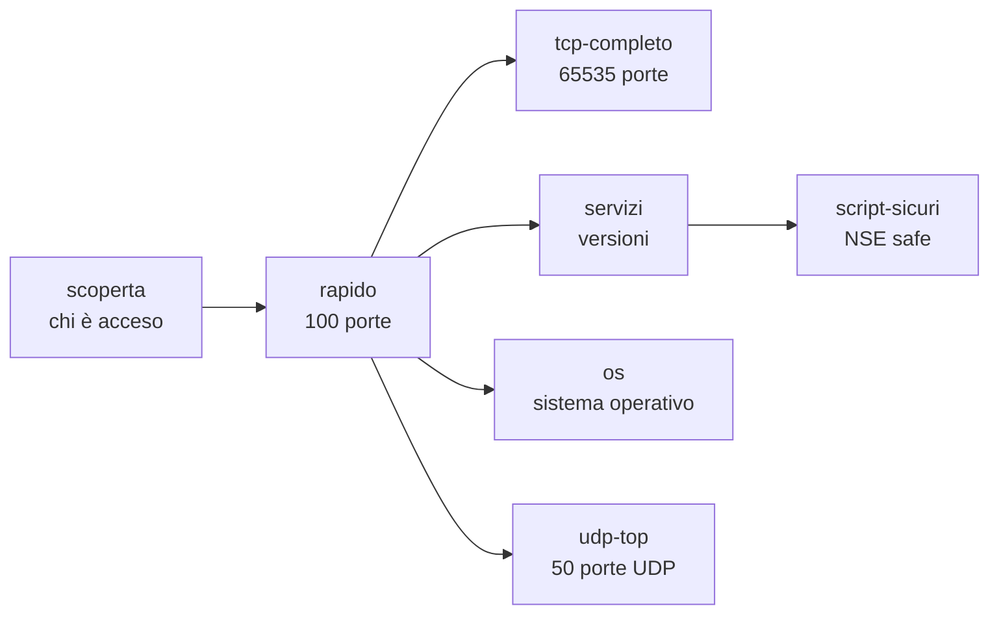

# Profili e flag vietati

🌐 **Italiano** · [English](en/04-profili.md) · [中文](zh/04-profili.md)

Un profilo è un insieme di flag Nmap con un nome, una descrizione e un'indicazione di quando ha senso usarlo. Sono pochi di proposito. Per ogni profilo trovi qui sotto cosa fa davvero e cosa lascia nei log del bersaglio.

## Il percorso tipico



Non è obbligatorio seguirlo, ma ogni passo costa di più del precedente in tempo e in rumore, quindi conviene fermarsi quando hai già la risposta.

## I profili

**scoperta** (`-sn -T3`). Su una rete locale Nmap usa ARP, che non si può filtrare, quindi trova anche i dispositivi che ignorano il ping. Da fuori usa ICMP e qualche SYN su 80 e 443. Non tocca nessuna porta oltre a quelle.

**rapido** (`--top-ports 100 -T3`). Le cento porte più frequenti secondo le statistiche di Nmap. Senza root usa la scansione connect, con root la SYN: Nmap sceglie da solo. È il primo comando da lanciare su un host singolo.

**tcp-completo** (`-p- -T3 --max-retries 2`). Tutte le porte. Su un host singolo di solito bastano pochi minuti. Su un /24 può richiedere ore, e un servizio che sta in ascolto su una porta alta e insolita è esattamente ciò che questo profilo trova e gli altri no.

**servizi** (`-sV --version-intensity 5 --top-ports 1000`). Apre davvero una conversazione con i servizi per capirne la versione. Questo lascia tracce nei log applicativi: non è più un semplice bussare alla porta. L'intensità 5 è il valore di Nmap per default, un compromesso tra velocità e precisione.

**os** (`-O --osscan-limit --top-ports 100`). Richiede root. Nmap stima il sistema operativo dal comportamento dello stack TCP/IP e per farlo bene ha bisogno di una porta aperta e di una chiusa. `--osscan-limit` salta gli host che non le hanno, perché il risultato sarebbe una congettura.

**udp-top** (`-sU --top-ports 50`). Richiede root. UDP è lento perché una porta aperta spesso non risponde affatto e Nmap deve aspettare e ritentare. Le cinquanta porte coprono DNS, SNMP, NTP, DHCP e simili.

**script-sicuri** (`--script "default and safe"`). Gli script NSE che appartengono sia alla categoria `default` sia a `safe`. Vuol dire che gli autori li considerano innocui per il bersaglio. "Safe" è un'etichetta data da persone: prima di usarli su un sistema che non puoi permetterti di rompere, leggi cosa fa lo script.

## Temporizzazione

Tutti i profili usano `-T3`, il valore normale di Nmap. Non c'è un profilo che vada più veloce, perché la fretta è la prima causa di servizi che cadono. Se ti serve più lentezza, passa `-- -T2`. Se ti serve più velocità, chiediti se il cliente è d'accordo.

## Passare flag a mano

Tutto ciò che scrivi dopo `--` finisce a Nmap, dopo i flag del profilo, a patto che non sia nell'elenco dei vietati.

```sh
nmap-cli scansiona rapido 192.168.56.10 --scope scope.toml -- -Pn -p 22,443 --reason
```

### Elenco dei vietati

| Flag | Perché |
|---|---|
| `-iL`, `-iR` | leggono target da file o li scelgono a caso: aggirano lo scope |
| `--exclude`, `--excludefile` | le esclusioni si dichiarano nello scope, non a riga di comando |
| `--resume` | riprende una scansione che non è passata dal controllo |
| `-sI` | idle scan: usa un host terzo come zombie |
| `-b` | FTP bounce: usa un server FTP terzo |
| `-D`, `-S` | decoy e falsificazione dell'indirizzo sorgente |
| `--proxies` | instrada il traffico da terzi |
| `--spoof-mac` | falsifica il MAC |
| `--script`, `--script-args-file`, `-sC`, `-A` | gli script si scelgono col profilo: `-sC` e `-A` attiverebbero gli script `default` dalla porta di servizio |
| `--datadir` | cambia i dati con cui Nmap decide cosa fare |
| `-oN`, `-oX`, `-oG`, `-oA`, `-oS` | l'output lo gestisce nmap-cli |

Il confronto rispetta le maiuscole sui flag corti, come fa Nmap: `-sI` è vietato, `-si` non esiste. Il valore attaccato al flag (`-oXfile`, `-iLfile`) viene riconosciuto lo stesso.

### Quello che il filtro non fa

Non è una sandbox. Se vuoi aggirarlo ci riesci, per esempio chiamando `nmap` direttamente. Serve a fermare gli errori e le abitudini sbagliate, non a fermare un malintenzionato che ha già accesso al tuo terminale.

Se ti serve qualcosa che qui è vietato, per esempio un decoy durante un test di rilevamento intrusioni concordato con il cliente, usa Nmap direttamente e annota la scelta nell'ingaggio.

Lo stesso vale per il brute force sulle credenziali, che `nmap-cli` non automatizza di proposito: il perché e il modo di farlo a mano sono in [11-brute-force.md](11-brute-force.md).
