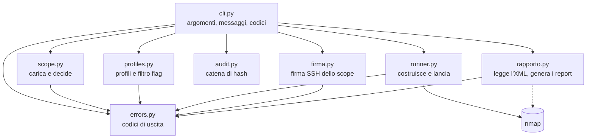
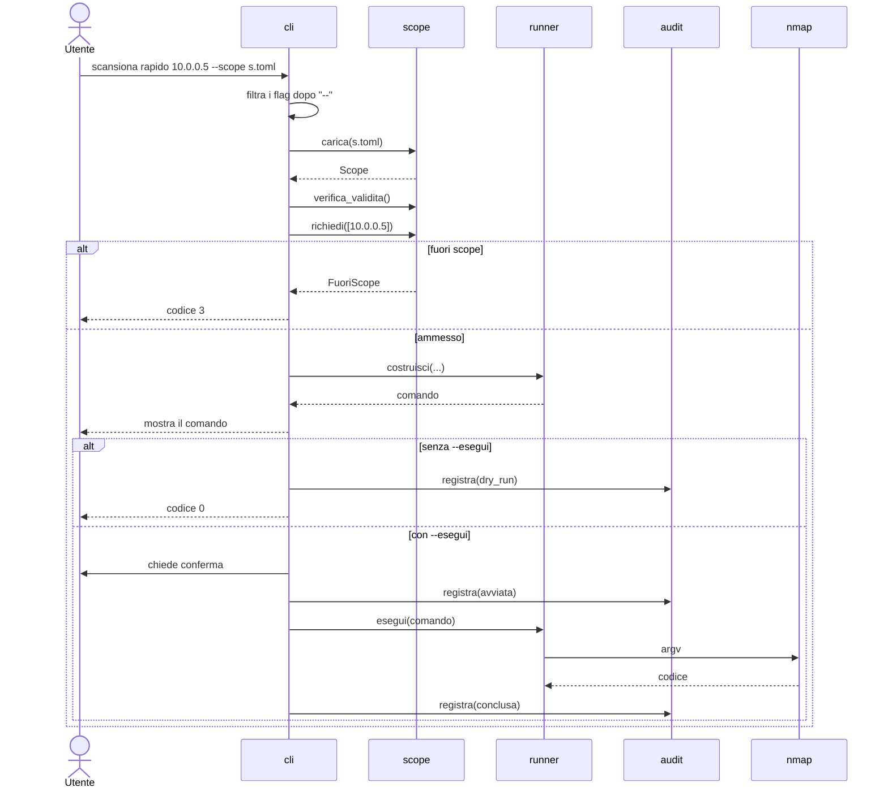

# Architettura

🌐 **Italiano** · [English](en/06-architettura.md) · [中文](zh/06-architettura.md)

Poco codice, ciascun pezzo con un compito solo. Si legge tutto in un pomeriggio.

## I moduli



`scope.py`, `profiles.py`, `audit.py` e `rapporto.py` non sanno niente l'uno dell'altro e non lanciano processi. Solo `runner.py` e `firma.py` toccano `subprocess` (il secondo per chiamare `ssh-keygen`). Questo rende i test veloci e senza rete: nessun test ha bisogno di Nmap.

`rapporto.py` legge l'XML che Nmap *ha già prodotto* (la freccia tratteggiata), non lo lancia: è un consumatore di un file, non un altro punto che tocca la rete.

## Il percorso di un comando



## Scelte che meritano una spiegazione

**Mai una shell.** Il comando è una lista di argomenti passata a `subprocess.run`. Un target come `10.0.0.5; rm -rf ~` non può fare niente: verrebbe prima rifiutato dallo scope, e anche se arrivasse a Nmap sarebbe un nome di host strano e basta. In più il comando usa `--` prima dei target, così nessun target viene letto come flag.

**Validare tutto o niente.** Se dieci target sono ammessi e uno no, non parte nulla. La scansione parziale è peggio di nessuna scansione: ti fa credere di aver coperto un perimetro che non hai coperto.

**Il filtro sui flag è per prefisso.** Nmap accetta il valore attaccato al flag, quindi `-oXfile` e `-oX file` sono la stessa cosa. Confrontare per uguaglianza esatta lascerebbe passare la prima forma.

**L'audit viene scritto prima dell'avvio.** Se il processo muore a metà o viene interrotto con un segnale, la riga `avviata` esiste e `conclusa` no: è un'informazione utile. Al contrario, scrivere solo a scansione finita farebbe sparire i lanci interrotti.

**Python 3.11 come minimo.** Serve `tomllib` nella libreria standard, per non dipendere da un parser TOML esterno.

**Il bersaglio è un dato, mai testo fidato, neanche nei report.** Il target che scrivi tu passa dallo scope prima di arrivare a Nmap. Ma Nmap, a sua volta, legge dal bersaglio hostname (reverse DNS), banner di servizio e versioni — testo che un sistema ostile controlla. `rapporto.py` tratta quei campi come dati anche quando li scrive nel report: toglie i caratteri di controllo (gli a capo compresi, che altrimenti aprirebbero una riga nuova nel documento) e scappa i caratteri strutturali di Markdown, così il bersaglio non può iniettare un titolo, una riga o una colonna che chi legge il report — umano o un altro strumento — scambierebbe per genuina. Il dettaglio è in [08-rapporti.md](08-rapporti.md#hostname-servizi-e-versioni-sono-dati-del-bersaglio-non-testo-fidato).

## Limiti

Quello che ti serve sapere prima di fidarti.

1. Il file di scope è una dichiarazione dell'utente. Se è sbagliato, il controllo è inutile.
2. Chi lancia `nmap` direttamente non passa da qui.
3. Il filtro sui flag non è una sandbox.
4. Tra la risoluzione DNS fatta da `scope.py` e quella fatta da Nmap passa del tempo.
5. L'audit rileva manomissioni parziali, non una riscrittura completa. Vedi [05-audit.md](05-audit.md).
6. Su sistemi dove `os.geteuid` non esiste (Windows) i controlli sui privilegi non funzionano. Il progetto è provato solo su macOS e Linux.

## Eseguire i test

```sh
python3 -m unittest discover -s tests -t .
```

I test di `test_cli.py` chiamano `cli.main()` in un'altra cartella temporanea e non lanciano mai Nmap: il percorso con `--esegui` è coperto solo fino alla conferma rifiutata. La prova completa con Nmap reale va fatta a mano, sul lab.
