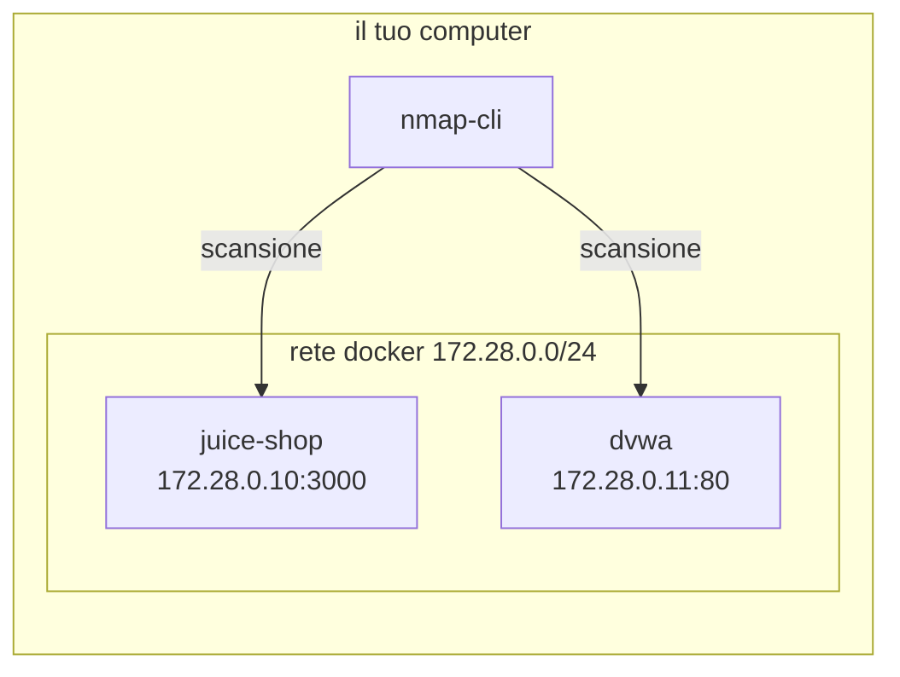

# Il lab

🌐 **Italiano** · [English](en/07-lab.md) · [中文](zh/07-lab.md)

Per imparare serve qualcosa da scansionare che sia tuo. In `lab/` c'è un `docker-compose.yml` che avvia due bersagli volutamente vulnerabili su una rete isolata.



Le due applicazioni sono progetti pubblici fatti apposta per essere attaccati: OWASP Juice Shop e DVWA. Non esporle mai su una rete vera, e non scansionare altro che questi indirizzi.

## Avvio

```sh
cd lab
docker compose up -d
```

Lo scope per il lab è già pronto in `examples/scope.lab.toml`. Le date vanno aggiornate: quelle d'esempio scadono.

```sh
nmap-cli verifica 172.28.0.10 172.28.0.11 --scope examples/scope.lab.toml
nmap-cli scansiona rapido 172.28.0.10 --scope examples/scope.lab.toml
nmap-cli scansiona servizi 172.28.0.10 172.28.0.11 --scope examples/scope.lab.toml --esegui
```

Provane uno che deve fallire, per vedere il codice 3:

```sh
nmap-cli scansiona rapido 172.28.0.10 8.8.8.8 --scope examples/scope.lab.toml; echo $?
```

## Esercizi

1. Confronta l'output di `rapido` e `tcp-completo` su Juice Shop. Trova una porta che il primo non vede, se c'è.
2. Aggiungi `172.28.0.11` a `esclude` e rilancia i due target insieme. Cosa succede, e perché non parte nemmeno il primo?
3. Cambia `valido_fino` con una data passata. Quale codice ottieni?
4. Apri `nmap-cli.audit.jsonl`, cambia a mano una lettera in una riga a metà e lancia `nmap-cli audit`.
5. Prova a passare `-- -iL liste.txt` e leggi il messaggio.

## Pulizia

```sh
docker compose down
```

## Nota

Il compose file non è stato provato su ogni versione di Docker. Se il comando fallisce, controlla che le immagini esistano ancora sul registro e che la rete `172.28.0.0/24` non confligga con una già in uso sul tuo computer.
