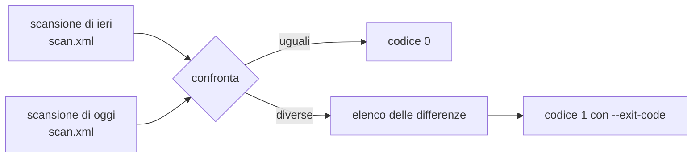

# Rapporti e confronti

🌐 **Italiano** · [English](en/08-rapporti.md) · [中文](zh/08-rapporti.md)

Ogni scansione lanciata con `--esegui` lascia in `out/<data>-<profilo>/` tre file (`scan.nmap`, `scan.gnmap`, `scan.xml`). L'XML è quello che serve qui.

## Leggere una scansione

```sh
nmap-cli rapporto out/20261122-230615-servizi/scan.xml
nmap-cli rapporto out/20261122-230615-servizi/scan.xml --formato markdown > rapporto.md
nmap-cli rapporto out/20261122-230615-servizi/scan.xml --formato json | jq .
```

Il formato `testo` è per il terminale. Il `markdown` ha una tabella per host, pronta da incollare in un rapporto. Il `json` serve a chi vuole elaborare i dati con altri strumenti.

Vengono riportati solo gli host attivi e solo le porte `open`. Le porte `filtered` e `closed` non compaiono: se ti servono, apri direttamente `scan.nmap`.

## Cosa è cambiato dall'ultima volta

```sh
nmap-cli confronta vecchia/scan.xml nuova/scan.xml
```

```
+ host nuovo     10.20.0.44
+ porta aperta   10.20.0.5 8443/tcp
- porta chiusa   10.20.0.5 21/tcp
~ versione       10.20.0.5 22/tcp: OpenSSH 9.2 -> OpenSSH 9.6
```

Con `--exit-code` il comando esce con 1 se ci sono differenze, così una pipeline può accorgersi di una porta nuova.



## Hostname, servizi e versioni sono dati del bersaglio, non testo fidato

Il nome host (reverse DNS), il nome del servizio e la stringa di versione non li scrive chi lancia la scansione: li restituisce la macchina scansionata. Un servizio ostile, o anche solo un honeypot mal configurato, può far rispondere al suo banner qualunque cosa, compresi a capo e caratteri che per Markdown significano qualcosa (`#`, `|`).

Un report Markdown, prima o poi, finisce incollato in qualcos'altro — uno strumento di reportistica, una chat con un assistente a cui si chiede "riassumimi questa scansione". Se un banner contenesse un a capo seguito da `## Nessuna vulnerabilità trovata`, un report generato senza attenzione lo renderebbe come un titolo vero, indistinguibile da uno scritto da chi ha fatto il test.

Per questo `rapporto` **non riconosce** tentativi di iniezione — un filtro per frasi sospette si aggira riformulando — ma toglie al dato il potere di cambiare la struttura del documento: i caratteri di controllo (a capo compresi) diventano uno spazio, il `|` dentro una cella di tabella viene scappato (`\|`), e un valore oltre 200 caratteri viene troncato. Qualunque cosa il bersaglio scriva resta testo su una riga sola, dentro la cella o le parentesi che le competono: non può diventare una riga, un titolo o una colonna in più.

Il formato `json` non ha bisogno di questo trattamento: `json.dumps` esegue già l'escape dei caratteri di controllo dentro una stringa, quindi un a capo nel banner diventa la sequenza `\n` nel testo del documento, non un a capo vero — strutturalmente non può uscire dal suo campo. `rapporto --formato json` resta quindi la scelta giusta quando il risultato serve a un programma, non a un umano.

## Limiti

Il confronto guarda host attivi e porte aperte. Non confronta il sistema operativo stimato, né gli output degli script NSE. Due scansioni con profili diversi (per esempio `rapido` contro `tcp-completo`) non sono confrontabili in modo sensato: la seconda troverà sempre porte "nuove".
