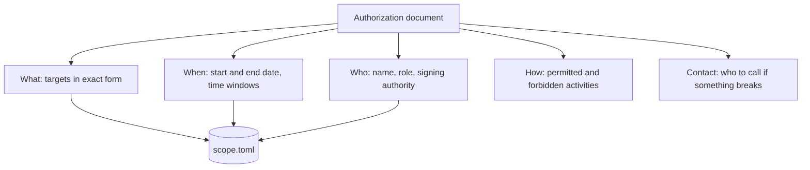

# Authorization

🌐 [Italiano](../02-autorizzazione.md) · **English** · [中文](../zh/02-autorizzazione.md)

A scan without permission doesn't become legitimate because it went fine. This page covers what you need beforehand, who can give it, and where you can practice without asking anyone.

## Who can authorize

Only whoever controls the system. Your manager isn't enough if the servers belong to a client. The client's technical contact isn't enough if the servers sit with a cloud provider whose contract forbids testing. Often you need two authorizations: one from the owner of the data and one from whoever hosts the infrastructure.

## What the document must state

Every field in the document has a place in the scope file. If you can't fill in a field, that piece of the authorization is missing.

One point that gets overlooked: "permitted activities". A full all-ports scan of an industrial control system, or of an old network printer, can hang the device. If the client has fragile systems, write it in the document and use the `rapido` or `scoperta` profile.

## Before you run

A short list, to read every time:

1. I have the signed document and can find it again six months from now.
2. The scope file says the same thing as the document, not a more convenient version.
3. The dates are still valid.
4. I know who to call if a service stops responding.
5. I'm using the least noisy profile that does the job.

## Where to practice without asking

| Where | Notes |
|---|---|
| This repo's lab | Your own containers on a local network. See [07-lab.md](07-lab.md). |
| Your own virtual machines | VirtualBox, UTM, any hypervisor, host-only network. |
| `scanme.nmap.org` | Provided by the Nmap project. A few scans, nothing aggressive. Check the policy on the site. |
| Hack The Box, TryHackMe | Within the platform's rules, only on the machines assigned to you. |
| Bug bounty | Only the targets in the program's scope, and respect its list of prohibited activities. |

A note on `scanme.nmap.org`: it's a free service offered by an open source project. Treat it the way you'd treat a friend's bathroom: use it without leaving a mark.

## What to do if you get it wrong

It happens. A badly pasted address, a network that turned out to belong to someone else.

1. Stop the scan (Ctrl-C).
2. Don't delete anything: the audit log is your proof of good faith and records exactly what was run.
3. Notify the client's contact immediately, or the system owner if that isn't the client. Better an embarrassing phone call today than a criminal complaint later.
4. Write down what happened while you still remember it.

## One last thing

The scope file is your own statement, not proof. No program can know whether you really have permission. If you put an address in the scope that wasn't assigned to you, `nmap-cli` will scan it, and the log will have your name next to it.
