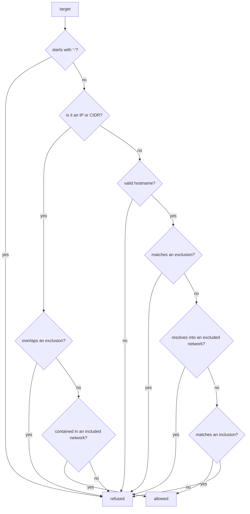

# The scope file

🌐 [Italiano](../03-scope.md) · **English** · [中文](../zh/03-scope.md)

The scope is a TOML file with two sections. `nmap-cli init` creates one for you to fill in.

```toml
[engagement]
nome = "ACME-rete-interna"
autorizzato_da = "Maria Rossi, CISO, Acme S.p.A."
riferimento = "ACME-2026-014"
valido_dal = 2026-11-02
valido_fino = 2026-11-13

[scope]
include = [
    "10.20.0.0/24",
    "192.168.56.10",
    "staging.acme.example",
    "*.lab.acme.example",
]
esclude = [
    "10.20.0.1",
    "stampanti.lab.acme.example",
]
```

## The `[engagement]` fields

All of them are required. If one is missing, the program exits with code 4.

| Field | What goes in it |
|---|---|
| `nome` | a short label to identify the engagement in the logs |
| `autorizzato_da` | person, role and company of whoever signed |
| `riferimento` | contract or letter number. It's also the phrase you must type to confirm an execution |
| `valido_dal`, `valido_fino` | TOML dates, both ends inclusive |

Outside those dates the scope isn't valid and no command runs, not even a dry-run.

## `include` and `esclude` entries

| Form | Example | Meaning |
|---|---|---|
| Single IP | `192.168.56.10` | that address |
| CIDR network | `10.20.0.0/24` | the whole network |
| Hostname | `staging.acme.example` | only that name |
| Wildcard | `*.lab.acme.example` | any subdomain, not the domain itself |

IPv4 and IPv6 work the same way and are never confused with each other.

## How the decision is made



Exclusion always wins. If you include `10.20.0.0/24` and exclude `10.20.0.1`, the target `10.20.0.0/24` is refused as a whole, because it contains the excluded address. Scan the individual hosts, or split the network into blocks that avoid it.

## Things the program refuses on purpose

**A CIDR with host bits set**, such as `10.20.0.5/24`. Nmap reads it as the whole `/24`. Here it's an error: write `10.20.0.5` or `10.20.0.0/24`, depending on what you meant.

**Nmap-style ranges**, such as `10.20.0.1-50` or `10.20.0-3.*`. They're convenient, but impossible to compare precisely. Use a CIDR.

**`0.0.0.0/0` in the inclusions**, i.e. the entire internet. A scope that authorizes everything is not a scope.

**Wildcards on a top-level domain**, such as `*.org`.

**Targets starting with `-`**. They're Nmap flags in disguise.

## Hostnames and DNS

A hostname is allowed only if it's written in the scope. It isn't resolved to check whether it "happens" to fall inside an included network, because DNS can change under your feet.

However, if the scope has network exclusions, every hostname is resolved and refused if the result falls in one of them. That way `staging.acme.example` can't quietly point at the router you excluded.

An honest limitation: between the resolution done here and the one Nmap does a moment later, DNS may answer differently. For tests where it matters, scan IP addresses.

## Where to keep the file

Outside the repository. This project's `.gitignore` excludes `scope.toml`, but don't rely on it: client names and their networks don't belong in a repository, not even a private one. The audit log contains the hash of the scope file, so if you edit it after a scan, it shows.
