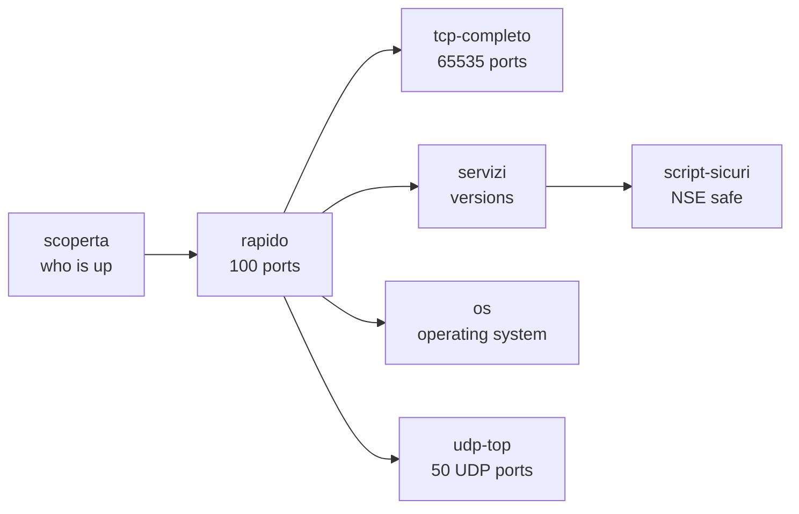

# Profiles and forbidden flags

🌐 [Italiano](../04-profili.md) · **English** · [中文](../zh/04-profili.md)

A profile is a set of Nmap flags with a name, a description, and a note on when it makes sense to use it. There are few of them on purpose. For each profile, below is what it actually does and what it leaves in the target's logs.

## The typical path



You don't have to follow it, but each step costs more than the previous one in time and noise, so stop once you have your answer.

## The profiles

**scoperta** (`-sn -T3`). On a local network Nmap uses ARP, which can't be filtered, so it also finds devices that ignore ping. From outside it uses ICMP and a few SYNs to 80 and 443. It touches no ports beyond those.

**rapido** (`--top-ports 100 -T3`). The hundred most common ports according to Nmap's statistics. Without root it uses a connect scan, with root a SYN scan: Nmap picks on its own. It's the first command to run against a single host.

**tcp-completo** (`-p- -T3 --max-retries 2`). All ports. On a single host a few minutes is usually enough. On a /24 it can take hours, and a service listening on an unusual high port is exactly what this profile finds and the others don't.

**servizi** (`-sV --version-intensity 5 --top-ports 1000`). Actually opens a conversation with the services to work out their version. This leaves traces in application logs: it's no longer just knocking on the port. Intensity 5 is Nmap's default, a compromise between speed and accuracy.

**os** (`-O --osscan-limit --top-ports 100`). Requires root. Nmap estimates the operating system from the behavior of the TCP/IP stack, and to do it well it needs one open and one closed port. `--osscan-limit` skips hosts that don't have them, because the result would be a guess.

**udp-top** (`-sU --top-ports 50`). Requires root. UDP is slow because an open port often doesn't respond at all and Nmap has to wait and retry. The fifty ports cover DNS, SNMP, NTP, DHCP and the like.

**script-sicuri** (`--script "default and safe"`). The NSE scripts that belong to both the `default` and `safe` categories. That means their authors consider them harmless to the target. "Safe" is a label assigned by people: before using them on a system you can't afford to break, read what the script does.

## Timing

All profiles use `-T3`, Nmap's normal value. There's no faster profile, because haste is the leading cause of services going down. If you need it slower, pass `-- -T2`. If you need it faster, ask yourself whether the client agrees.

## Passing flags by hand

Everything you write after `--` goes to Nmap, after the profile's flags, provided it isn't on the forbidden list.

```sh
nmap-cli scansiona rapido 192.168.56.10 --scope scope.toml -- -Pn -p 22,443 --reason
```

### Forbidden list

| Flag | Why |
|---|---|
| `-iL`, `-iR` | read targets from a file or pick them at random: they bypass the scope |
| `--exclude`, `--excludefile` | exclusions are declared in the scope, not on the command line |
| `--resume` | resumes a scan that never went through the check |
| `-sI` | idle scan: uses a third-party host as a zombie |
| `-b` | FTP bounce: uses a third-party FTP server |
| `-D`, `-S` | decoys and source address spoofing |
| `--proxies` | routes traffic through third parties |
| `--spoof-mac` | spoofs the MAC address |
| `--script`, `--script-args-file`, `-sC`, `-A` | scripts are chosen via the profile: `-sC` and `-A` would enable the `default` scripts through the back door |
| `--datadir` | changes the data Nmap uses to decide what to do |
| `-oN`, `-oX`, `-oG`, `-oA`, `-oS` | output is handled by nmap-cli |

Matching is case-sensitive for short flags, as in Nmap: `-sI` is forbidden, `-si` doesn't exist. A value attached to the flag (`-oXfile`, `-iLfile`) is recognized all the same.

### What the filter doesn't do

It isn't a sandbox. If you want to get around it, you can, for example by calling `nmap` directly. It's there to stop mistakes and bad habits, not an attacker who already has access to your terminal.

If you need something that's forbidden here, for example a decoy during an intrusion detection test agreed with the client, use Nmap directly and record the decision in the engagement.

The same goes for credential brute force, which `nmap-cli` does not automate on purpose: the why and the manual way to do it are in [11-brute-force.md](11-brute-force.md).
