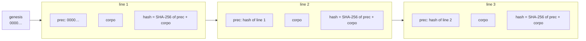

# The audit log

🌐 [Italiano](../05-audit.md) · **English** · [中文](../zh/05-audit.md)

Every time you run `nmap-cli scansiona`, a line is appended to `nmap-cli.audit.jsonl` (or to the file you specify with `--audit`). Its job is to answer three questions months later: what was run, by whom, under which authorization.

## What gets written

| Event | When |
|---|---|
| `dry_run` | you ran without `--esegui` |
| `rifiutato` | you asked for `--esegui` but the confirmation didn't come |
| `avviata` | before starting Nmap |
| `conclusa` | when Nmap exits, with its exit code |

An out-of-scope target produces no line: the program exits earlier, and nothing was started that needs recording.

Each line contains the UTC timestamp, the engagement name, the reference, the system user, the profile, the targets, the full command, and the SHA-256 of the scope file in use at that moment. That last one is there to prove the scope wasn't touched up afterwards.

## The chain

Each line includes the hash of the previous line. If you change a line in the middle, its hash no longer matches, and every line after it points to a hash that doesn't exist.



To check it:

```sh
nmap-cli audit
nmap-cli audit /percorso/altro.audit.jsonl
```

If the chain is intact it prints the number of lines and exits with 0. If not, it tells you at which line it breaks and exits with 7.

## What it protects and what it doesn't

It detects modification or deletion of a line in the middle, and insertion of a fake line in the middle.

It doesn't detect two things. First: anyone with write access to the file can rebuild the chain from scratch, recomputing every hash, and the result passes verification. Second: anyone who removes the last lines leaves a valid chain, just a shorter one.

Covering those cases needs something outside the file. Two simple options: copy the last hash somewhere you aren't the only one in control of (an email to the client, a ticket), or ship the log to an append-only remote log server. `nmap-cli` doesn't do this for you because it depends on the infrastructure you have.

## Confidentiality

The log contains client addresses. Treat it as client data: it doesn't go in public repositories or in chats. The `.gitignore` excludes it, but check before every commit.
