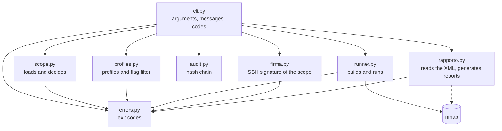
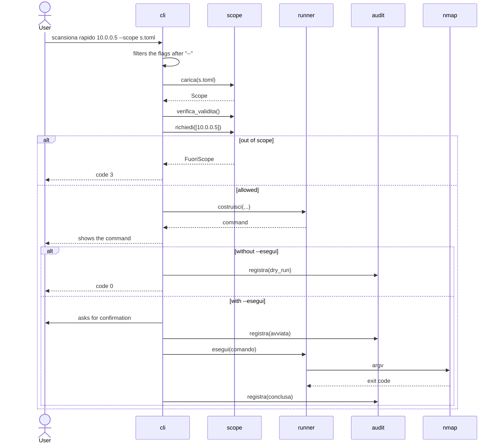

# Architecture

🌐 [Italiano](../06-architettura.md) · **English** · [中文](../zh/06-architettura.md)

Little code, each piece with a single job. You can read all of it in an afternoon.

## The modules



`scope.py`, `profiles.py`, `audit.py` and `rapporto.py` know nothing about each other and don't start processes. Only `runner.py` and `firma.py` touch `subprocess` (the latter to call `ssh-keygen`). That keeps the tests fast and offline: no test needs Nmap.

`rapporto.py` reads the XML that Nmap *has already produced* (the dashed arrow); it doesn't run it. It consumes a file; it isn't another component that touches the network.

## The path of a command



## Choices worth explaining

**Never a shell.** The command is a list of arguments passed to `subprocess.run`. A target like `10.0.0.5; rm -rf ~` can't do anything: the scope would refuse it first, and even if it reached Nmap it would just be an odd hostname. On top of that, the command puts `--` before the targets, so no target is ever read as a flag.

**Validate all or nothing.** If ten targets are allowed and one isn't, nothing runs. A partial scan is worse than no scan: it makes you believe you covered a perimeter you didn't.

**The flag filter matches by prefix.** Nmap accepts a value attached to the flag, so `-oXfile` and `-oX file` are the same thing. Exact-match comparison would let the first form through.

**The audit is written before launch.** If the process dies halfway or is interrupted by a signal, the `avviata` line exists and `conclusa` doesn't: that's useful information. Writing only once the scan has finished would make interrupted runs disappear.

**Python 3.11 minimum.** `tomllib` is needed in the standard library, to avoid depending on an external TOML parser.

**The target is data, never trusted text, not even in reports.** The target you type goes through the scope before it reaches Nmap. But Nmap in turn reads hostnames (reverse DNS), service banners and versions from the target — text that a hostile system controls. `rapporto.py` treats those fields as data even when writing them into the report: it strips control characters (newlines included, which would otherwise start a new line in the document) and escapes Markdown structural characters, so the target can't inject a heading, a row or a column that whoever reads the report — a human or another tool — would take as genuine. Details in [08-rapporti.md](08-rapporti.md#hostnames-services-and-versions-are-target-data-not-trusted-text).

## Limitations

What you need to know before trusting it.

1. The scope file is a statement by the user. If it's wrong, the check is useless.
2. Anyone who runs `nmap` directly doesn't go through here.
3. The flag filter is not a sandbox.
4. Time passes between the DNS resolution done by `scope.py` and the one done by Nmap.
5. The audit detects partial tampering, not a complete rewrite. See [05-audit.md](05-audit.md).
6. On systems where `os.geteuid` doesn't exist (Windows) the privilege checks don't work. The project is tested only on macOS and Linux.

## Running the tests

```sh
python3 -m unittest discover -s tests -t .
```

The tests in `test_cli.py` call `cli.main()` in a separate temporary directory and never run Nmap: the `--esegui` path is covered only up to the refused confirmation. The full test with real Nmap has to be done by hand, on the lab.
