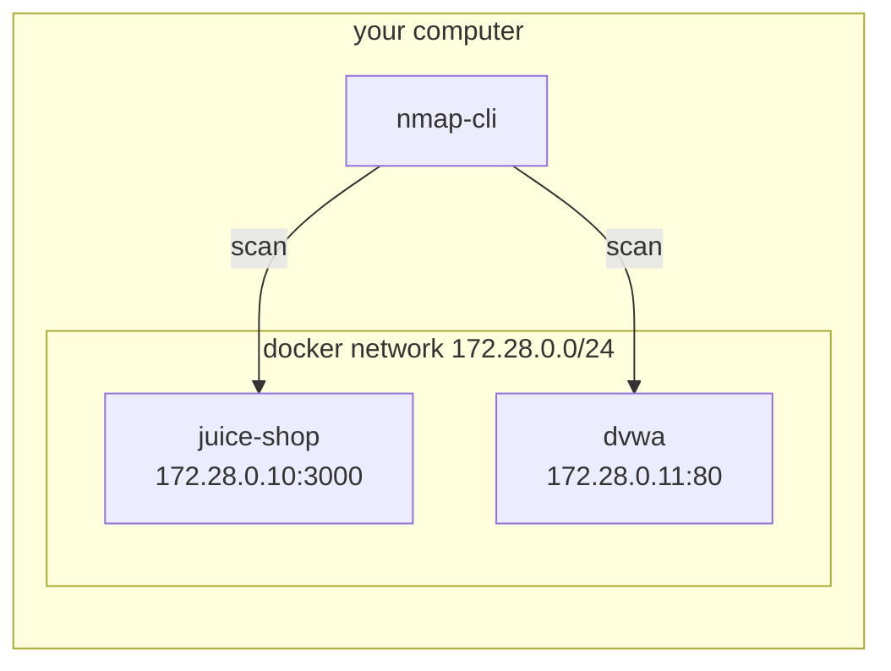

# The lab

🌐 [Italiano](../07-lab.md) · **English** · [中文](../zh/07-lab.md)

To learn, you need something of your own to scan. `lab/` contains a `docker-compose.yml` that starts two deliberately vulnerable targets on an isolated network.



The two applications are public projects built specifically to be attacked: OWASP Juice Shop and DVWA. Never expose them on a real network, and don't scan anything other than these addresses.

## Startup

```sh
cd lab
docker compose up -d
```

The lab scope is ready in `examples/scope.lab.toml`. The dates need updating: the sample ones expire.

```sh
nmap-cli verifica 172.28.0.10 172.28.0.11 --scope examples/scope.lab.toml
nmap-cli scansiona rapido 172.28.0.10 --scope examples/scope.lab.toml
nmap-cli scansiona servizi 172.28.0.10 172.28.0.11 --scope examples/scope.lab.toml --esegui
```

Try one that should fail, to see code 3:

```sh
nmap-cli scansiona rapido 172.28.0.10 8.8.8.8 --scope examples/scope.lab.toml; echo $?
```

## Exercises

1. Compare the output of `rapido` and `tcp-completo` against Juice Shop. Find a port the first one misses, if there is one.
2. Add `172.28.0.11` to `esclude` and rerun both targets together. What happens, and why doesn't even the first one start?
3. Change `valido_fino` to a past date. Which code do you get?
4. Open `nmap-cli.audit.jsonl`, change one letter by hand in a line in the middle, and run `nmap-cli audit`.
5. Try passing `-- -iL liste.txt` and read the message.

## Cleanup

```sh
docker compose down
```

## Note

The compose file hasn't been tested on every Docker version. If the command fails, check that the images still exist in the registry and that the `172.28.0.0/24` network doesn't conflict with one already in use on your computer.
