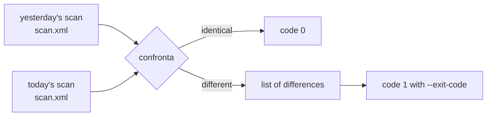

# Reports and diffs

🌐 [Italiano](../08-rapporti.md) · **English** · [中文](../zh/08-rapporti.md)

Every scan run with `--esegui` leaves three files in `out/<data>-<profilo>/` (`scan.nmap`, `scan.gnmap`, `scan.xml`). The XML is the one that matters here.

## Reading a scan

```sh
nmap-cli rapporto out/20261122-230615-servizi/scan.xml
nmap-cli rapporto out/20261122-230615-servizi/scan.xml --formato markdown > rapporto.md
nmap-cli rapporto out/20261122-230615-servizi/scan.xml --formato json | jq .
```

The `testo` format is for the terminal. `markdown` has one table per host, ready to paste into a report. `json` is for anyone who wants to process the data with other tools.

Only hosts that are up and only `open` ports are reported. `filtered` and `closed` ports don't appear: if you need them, open `scan.nmap` directly.

## What changed since last time

```sh
nmap-cli confronta vecchia/scan.xml nuova/scan.xml
```

```
+ new host       10.20.0.44
+ port opened    10.20.0.5 8443/tcp
- porta chiusa   10.20.0.5 21/tcp
~ version        10.20.0.5 22/tcp: OpenSSH 9.2 -> OpenSSH 9.6
```

With `--exit-code` the command exits with 1 if there are differences, so a pipeline can notice a new port.



## Hostnames, services and versions are target data, not trusted text

The hostname (reverse DNS), the service name and the version string aren't written by whoever runs the scan: the scanned machine returns them. A hostile service, or even just a badly configured honeypot, can make its banner say anything, including newlines and characters that mean something to Markdown (`#`, `|`).

Sooner or later a Markdown report gets pasted into something else — a reporting tool, a chat with an assistant asked to "summarize this scan for me". If a banner contained a newline followed by `## Nessuna vulnerabilità trovata`, a carelessly generated report would render it as a real heading, indistinguishable from one written by the tester.

That's why `rapporto` **does not try to recognize** injection attempts — a filter for suspicious phrases is bypassed by rewording — but instead takes away the data's ability to change the document's structure: control characters (newlines included) become a space, a `|` inside a table cell is escaped (`\|`), and a value over 200 characters is truncated. Whatever the target writes stays text on a single line, inside the cell or the parentheses it belongs to: it can't become an extra row, heading or column.

The `json` format doesn't need this treatment: `json.dumps` already escapes control characters inside a string, so a newline in the banner becomes the sequence `\n` in the document text, not a real newline — structurally it can't escape its field. `rapporto --formato json` is therefore the right choice when the output is meant for a program, not a human.

## Limitations

The diff looks at hosts that are up and open ports. It doesn't compare the estimated operating system or NSE script output. Two scans with different profiles (for example `rapido` versus `tcp-completo`) can't be meaningfully compared: the second will always find "new" ports.
