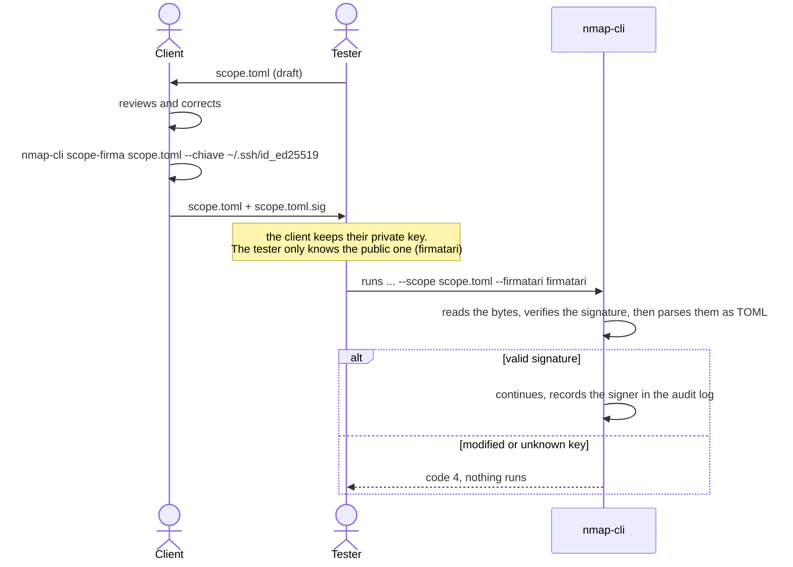

# Signed scope

🌐 [Italiano](../09-firma.md) · **English** · [中文](../zh/09-firma.md)

The scope is a statement. With a signature it becomes evidence: whoever has the authority to authorize signs it with their SSH key, and `nmap-cli` refuses to start if the file was modified after signing or if it was signed by a key it doesn't know.

All it needs is `ssh-keygen`, which ships with macOS and any Linux with OpenSSH. No extra dependencies.

## Who does what



Verification runs on the same bytes that are then parsed as the scope: there is no window between check and use in which the file could change.

## The signers file

It's OpenSSH's `allowed_signers` format, one line per key:

```
maria.rossi@acme.example namespaces="nmap-cli" ssh-ed25519 AAAAC3NzaC1lZDI1NTE5AAAA...
```

The `namespaces` field binds the key to this program: a signature made for `git` or anything else is not accepted, even if the key is the same.

## Steps

The client (or whoever holds the authority) signs:

```sh
nmap-cli scope-firma scope.toml --chiave ~/.ssh/id_ed25519
```

This creates `scope.toml.sig`. If the key has a passphrase, `ssh-keygen` asks for it. If a signature already exists, the command won't overwrite it: delete it by hand to re-sign.

The tester checks:

```sh
nmap-cli scope-verifica scope.toml --firmatari firmatari
# ok: valid signature by maria.rossi@acme.example (SHA256:...)
```

And then runs with the signature required:

```sh
nmap-cli scansiona rapido 192.168.56.10 --scope scope.toml --firmatari firmatari
```

Without `--firmatari` no signature is required. If you want it always required, put it in an alias.

## What goes into the audit log

Every line of the log, besides the hash of the scope file, carries `scope_firmato_da` and `scope_firma_fp` (the key fingerprint). So months later you can say not only which scope was in use but who had signed it.

## What it doesn't do

It doesn't know whether the person who signed really had the authority to authorize those systems: the contract settles that, not cryptography. It doesn't protect against a stolen private key. It doesn't stop anyone from running the tool without `--firmatari`, or from running the underlying tool directly.

A signature has no expiry of its own: its validity in time is what the file declares (`valido_dal`, `valido_fino`), and since that is signed it can't be quietly extended.
