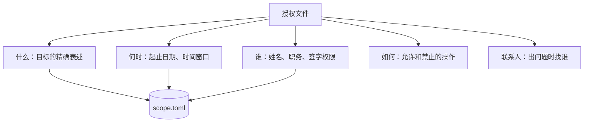

# 授权

🌐 [Italiano](../02-autorizzazione.md) · [English](../en/02-autorizzazione.md) · **中文**

> ⚠️ 本页为机器翻译草稿，正式发布前需母语者校对。

未经许可的扫描，不会因为“没出事”就变得合法。本页说明事前需要什么、谁有权授权，以及在哪里可以无需征得任何人同意就进行练习。

## 谁有权授权

只有对系统拥有控制权的人。如果服务器属于客户，你的上级授权是不够的。如果服务器托管在云服务商处，而服务商的合同禁止测试，那么客户的技术对接人授权也不够。很多时候需要两份授权：一份来自数据所有者，一份来自基础设施托管方。

## 授权文件应写明什么

文件中的每个字段在作用域文件里都有对应的位置。如果某个字段填不出来，说明这部分授权是缺失的。

有一点常被忽视：“允许的操作”。对工控设备或老旧网络打印机做全端口扫描，可能导致设备卡死。如果客户有脆弱的系统，请在文件中写明，并使用 `rapido` 或 `scoperta` 配置。

## 运行之前

一份简短的清单，每次都要过一遍：

1. 我手上有签字的文件，六个月后也能找得到。
2. 作用域文件的内容与授权文件一致，而不是一个更“方便”的版本。
3. 日期仍在有效期内。
4. 我知道某个服务停止响应时该找谁。
5. 我用的是满足需求的、噪声最小的配置。

## 无需授权的练习场所

| 场所 | 说明 |
|---|---|
| 本仓库的实验环境 | 你自己在本地网络上的容器。参见 [07-lab.md](07-lab.md)。 |
| 你自己的虚拟机 | VirtualBox、UTM 或任何虚拟化平台，使用 host-only 网络。 |
| `scanme.nmap.org` | 由 Nmap 项目提供。少量扫描，不要做激进操作。请查看网站上的使用政策。 |
| Hack The Box、TryHackMe | 遵守平台规则，只针对分配给你的机器。 |
| 漏洞赏金（Bug bounty） | 只针对项目作用域内的目标，并遵守禁止操作清单。 |

关于 `scanme.nmap.org` 再说一句：这是一个开源项目免费提供的服务。像对待朋友家的卫生间一样对待它——用完不留痕迹。

## 如果出了错

这种事会发生。地址粘贴错了，或者某个网段后来发现是别人的。

1. 停止扫描（Ctrl-C）。
2. 不要删除任何东西：审计日志是你善意的证明，它准确记录了运行过什么。
3. 立即通知客户的对接人；如果系统所有者不是客户，则通知系统所有者。今天打一个尴尬的电话，好过日后收到一纸诉状。
4. 趁记忆清晰，把经过写下来。

## 最后一点

作用域文件是你自己的声明，不是证据。没有任何程序能知道你是否真的获得了许可。如果你在作用域里写了一个并未分配给你的地址，`nmap-cli` 会照样扫描它，而日志里会在旁边记下你的名字。
