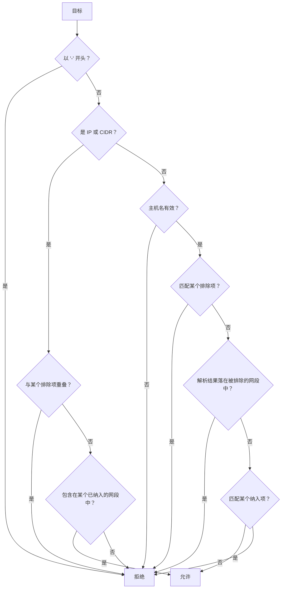

# 作用域文件

🌐 [Italiano](../03-scope.md) · [English](../en/03-scope.md) · **中文**

> ⚠️ 本页为机器翻译草稿，正式发布前需母语者校对。

作用域是一个包含两个段的 TOML 文件。`nmap-cli init` 会生成一个待填写的模板。

```toml
[engagement]
nome = "ACME-rete-interna"
autorizzato_da = "Maria Rossi, CISO, Acme S.p.A."
riferimento = "ACME-2026-014"
valido_dal = 2026-11-02
valido_fino = 2026-11-13

[scope]
include = [
    "10.20.0.0/24",
    "192.168.56.10",
    "staging.acme.example",
    "*.lab.acme.example",
]
esclude = [
    "10.20.0.1",
    "stampanti.lab.acme.example",
]
```

## `[engagement]` 的字段

全部必填。缺少任何一个，程序以退出码 4 退出。

| 字段 | 填写内容 |
|---|---|
| `nome` | 一个简短标签，用于在日志中识别该项目 |
| `autorizzato_da` | 签字人的姓名、职务和所属公司 |
| `riferimento` | 合同或授权函编号。它也是确认执行时需要输入的短语 |
| `valido_dal`, `valido_fino` | TOML 日期，首尾两天均包含在内 |

超出这一日期范围，作用域即失效，任何命令都不会运行，dry-run 也不例外。

## `include` 与 `esclude` 的条目

| 形式 | 示例 | 含义 |
|---|---|---|
| 单个 IP | `192.168.56.10` | 该地址 |
| CIDR 网段 | `10.20.0.0/24` | 整个网段 |
| 主机名 | `staging.acme.example` | 仅该名称 |
| 通配符 | `*.lab.acme.example` | 任意子域名，但不包括该域名本身 |

IPv4 和 IPv6 的处理方式相同，二者互不混淆。

## 判定流程



排除项永远优先。如果纳入了 `10.20.0.0/24` 并排除了 `10.20.0.1`，那么目标 `10.20.0.0/24` 会被整体拒绝，因为它包含被排除的地址。请逐个扫描单台主机，或者把网段拆分成避开该地址的若干块。

## 程序有意拒绝的情况

**主机位不为零的 CIDR**，例如 `10.20.0.5/24`。Nmap 会把它当作整个 `/24`。这里视为错误：按你的本意写成 `10.20.0.5` 或 `10.20.0.0/24`。

**Nmap 风格的地址范围**，例如 `10.20.0.1-50` 或 `10.20.0-3.*`。写起来方便，但无法精确比对。请改用 CIDR。

**纳入项中的 `0.0.0.0/0`**，即整个互联网。授权一切的作用域就不叫作用域。

**针对顶级域名的通配符**，例如 `*.org`。

**以 `-` 开头的目标**。它们是伪装成目标的 Nmap 标志。

## 主机名与 DNS

主机名只有在作用域中明确写出时才会被允许。程序不会为了判断它是否“碰巧”落在某个纳入网段内而去解析它，因为 DNS 可能在你不知情时发生变化。

但如果作用域中有网段类的排除项，每个主机名都会被解析；若解析结果落入其中任何一个，即予以拒绝。这样，`staging.acme.example` 就无法悄悄指向你已排除的路由器。

一个坦白的局限：从这里完成解析到片刻之后 Nmap 再次解析，DNS 的应答可能不同。对于结果要紧的测试，请直接扫描 IP 地址。

## 文件放在哪里

放在仓库之外。本项目的 `.gitignore` 已排除 `scope.toml`，但不要依赖它：客户名称和客户网络信息不应进入任何仓库，私有仓库也不行。审计日志中保存了作用域文件的哈希，因此扫描之后若修改了该文件，是能看出来的。
