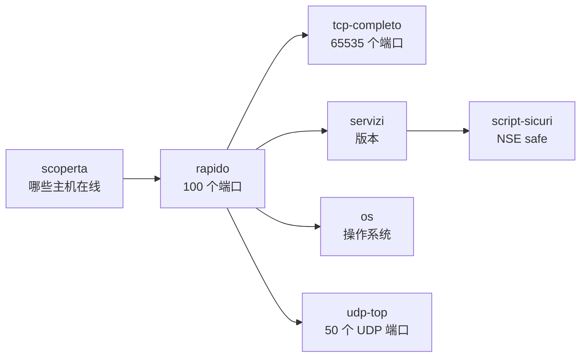

# 配置与被禁标志

🌐 [Italiano](../04-profili.md) · [English](../en/04-profili.md) · **中文**

> ⚠️ 本页为机器翻译草稿，正式发布前需母语者校对。

配置是一组带名称的 Nmap 标志，附有说明以及适用场景。配置数量有意保持很少。下面针对每个配置说明它实际做了什么，以及会在目标日志中留下什么。

## 典型路径



不一定要按这个顺序走，但每一步在耗时和噪声上都比上一步代价更高，所以一旦拿到答案就该停下。

## 各配置说明

**scoperta**（`-sn -T3`）。在本地网络中 Nmap 使用 ARP，而 ARP 无法被过滤，因此连忽略 ping 的设备也能发现。在外部则使用 ICMP 以及对 80 和 443 端口发送少量 SYN。除此之外不触碰任何端口。

**rapido**（`--top-ports 100 -T3`）。按 Nmap 统计最常见的一百个端口。没有 root 时使用 connect 扫描，有 root 时使用 SYN 扫描：由 Nmap 自行选择。对单台主机，这是第一条该运行的命令。

**tcp-completo**（`-p- -T3 --max-retries 2`）。全部端口。对单台主机通常几分钟就够了。对一个 /24 可能要几个小时；而监听在某个不常见高位端口上的服务，正是这个配置能发现、其他配置发现不了的。

**servizi**（`-sV --version-intensity 5 --top-ports 1000`）。真正与服务建立会话以识别版本。这会在应用日志中留下痕迹：已经不只是简单地敲一下端口了。强度 5 是 Nmap 的默认值，在速度与准确度之间取得平衡。

**os**（`-O --osscan-limit --top-ports 100`）。需要 root。Nmap 根据 TCP/IP 协议栈的行为推断操作系统，要想推断得准，需要一个开放端口和一个关闭端口。`--osscan-limit` 会跳过不满足条件的主机，因为那样得到的结果只是猜测。

**udp-top**（`-sU --top-ports 50`）。需要 root。UDP 很慢，因为开放端口往往根本不回应，Nmap 只能等待并重试。这五十个端口涵盖 DNS、SNMP、NTP、DHCP 等。

**script-sicuri**（`--script "default and safe"`）。同时属于 `default` 和 `safe` 两个类别的 NSE 脚本。也就是说，脚本作者认为它们对目标无害。“safe”是人打的标签：在你承受不起被搞坏的系统上使用之前，先读一下脚本具体做了什么。

## 时序

所有配置都使用 `-T3`，即 Nmap 的常规值。没有更快的配置，因为求快是服务宕机的头号原因。如果需要更慢，传入 `-- -T2`。如果需要更快，先问问自己客户是否同意。

## 手动传递标志

写在 `--` 之后的所有内容都会传给 Nmap，排在配置的标志之后，前提是它不在被禁列表中。

```sh
nmap-cli scansiona rapido 192.168.56.10 --scope scope.toml -- -Pn -p 22,443 --reason
```

### 被禁列表

| 标志 | 原因 |
|---|---|
| `-iL`, `-iR` | 从文件读取目标或随机选择目标：绕过作用域 |
| `--exclude`, `--excludefile` | 排除项应在作用域中声明，而不是在命令行上 |
| `--resume` | 恢复一次未经过校验的扫描 |
| `-sI` | idle 扫描：把第三方主机当作 zombie |
| `-b` | FTP bounce：利用第三方 FTP 服务器 |
| `-D`, `-S` | 诱饵（decoy）和源地址伪造 |
| `--proxies` | 经由第三方转发流量 |
| `--spoof-mac` | 伪造 MAC 地址 |
| `--script`, `--script-args-file`, `-sC`, `-A` | 脚本通过配置选择：`-sC` 和 `-A` 会变相启用 `default` 脚本 |
| `--datadir` | 更改 Nmap 用来做决策的数据 |
| `-oN`, `-oX`, `-oG`, `-oA`, `-oS` | 输出由 nmap-cli 管理 |

对短标志的比对区分大小写，与 Nmap 的行为一致：`-sI` 被禁，`-si` 并不存在。值直接紧贴在标志后面的写法（`-oXfile`、`-iLfile`）同样能被识别。

### 过滤器做不到的事

它不是沙箱。如果你想绕过它，总有办法，例如直接调用 `nmap`。它的作用是拦住失误和坏习惯，而不是拦住一个已经能操作你终端的恶意者。

如果你需要某个此处被禁的功能，例如在与客户约定好的入侵检测测试中使用诱饵，请直接使用 Nmap，并在项目记录中注明这一选择。

凭据暴力破解也是如此，`nmap-cli` 刻意不自动化它：原因以及手工操作的方法见 [11-brute-force.md](11-brute-force.md)。
