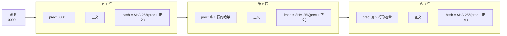

# 审计日志

🌐 [Italiano](../05-audit.md) · [English](../en/05-audit.md) · **中文**

> ⚠️ 本页为机器翻译草稿，正式发布前需母语者校对。

每次运行 `nmap-cli scansiona`，都会在 `nmap-cli.audit.jsonl`（或用 `--audit` 指定的文件）中追加一行。它的用途是在几个月后回答三个问题：运行了什么、由谁运行、依据哪份授权。

## 记录哪些内容

| 事件 | 何时 |
|---|---|
| `dry_run` | 运行时未加 `--esegui` |
| `rifiutato` | 请求了 `--esegui`，但未完成确认 |
| `avviata` | 启动 Nmap 之前 |
| `conclusa` | Nmap 退出时，附带其退出码 |

超出作用域的目标不会产生任何记录：程序会提前退出，没有启动任何需要记录的东西。

每一行包含 UTC 时间、项目名称、编号、系统用户、配置、目标、完整命令，以及当时所用作用域文件的 SHA-256。最后一项用来证明作用域事后未被改动。

## 哈希链

每一行都包含上一行的哈希。如果改动了中间某一行，它的哈希就对不上了，而其后的所有行都指向一个不存在的哈希。



检查方法：

```sh
nmap-cli audit
nmap-cli audit /percorso/altro.audit.jsonl
```

如果哈希链完整，会打印行数并以 0 退出。否则会指出在哪一行断开，并以 7 退出。

## 能防什么，不能防什么

它能检测到中间某行被修改或删除，以及在中间插入伪造的行。

有两种情况检测不到。其一：对该文件有写权限的人可以从头重建整条链，重新计算所有哈希，结果照样能通过验证。其二：删掉最后几行，留下的仍是一条有效的链，只是更短。

要覆盖这些情况，需要借助文件之外的东西。两个简单的办法：把最后一个哈希复制到一个不只由你掌控的地方（发给客户的一封邮件、一个工单），或者把日志发送到一台只允许追加的远程日志服务器。`nmap-cli` 不替你做这件事，因为这取决于你现有的基础设施。

## 保密

日志中包含客户的地址。请把它当作客户数据对待：不要放到公开仓库，也不要发到聊天里。`.gitignore` 已经排除了它，但每次提交前仍要检查。
