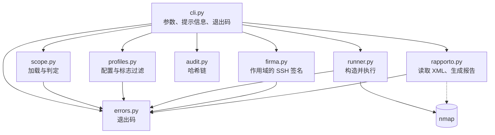
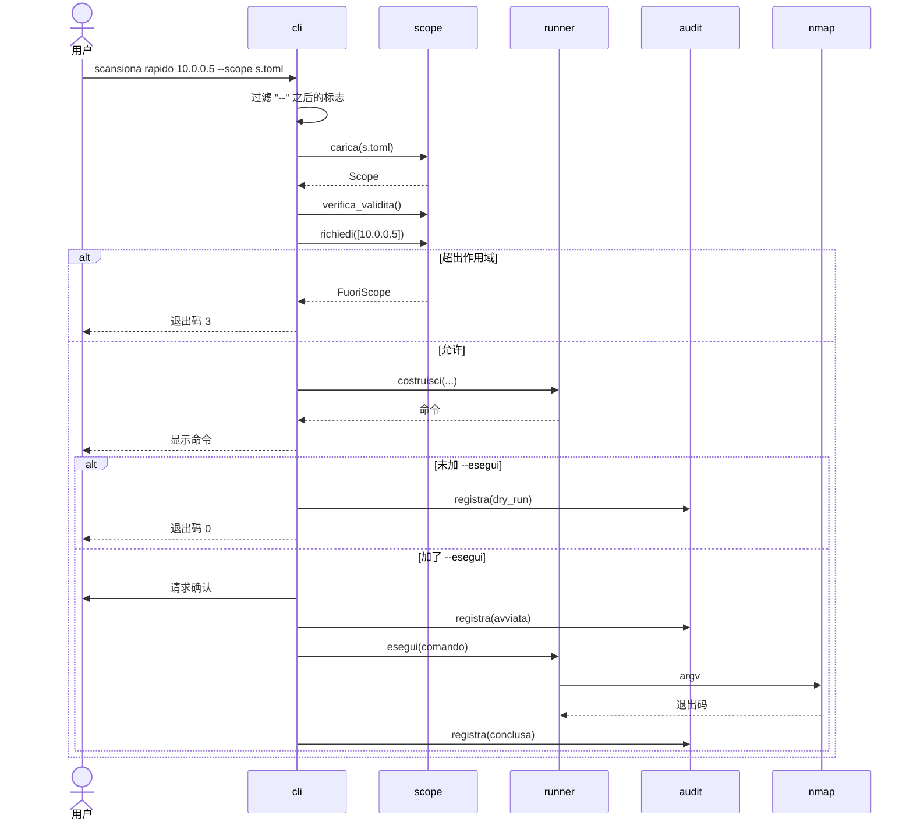

# 架构

🌐 [Italiano](../06-architettura.md) · [English](../en/06-architettura.md) · **中文**

> ⚠️ 本页为机器翻译草稿，正式发布前需母语者校对。

代码量很少，每个部分只负责一件事。一个下午就能读完。

## 模块



`scope.py`、`profiles.py`、`audit.py` 和 `rapporto.py` 彼此互不依赖，也不启动任何进程。只有 `runner.py` 和 `firma.py` 会用到 `subprocess`（后者用于调用 `ssh-keygen`）。这让测试既快又无需网络：没有任何测试需要 Nmap。

`rapporto.py` 读取的是 Nmap *已经生成*的 XML（图中的虚线箭头），它并不启动 Nmap：它只是一个文件的消费者，而不是又一个接触网络的环节。

## 一条命令的执行路径



## 值得解释的设计选择

**从不经过 shell。** 命令是一个参数列表，传给 `subprocess.run`。像 `10.0.0.5; rm -rf ~` 这样的目标什么也做不了：它会先被作用域拒绝；即使到了 Nmap 那里，也只是一个奇怪的主机名而已。此外，命令在目标之前加了 `--`，因此任何目标都不会被当作标志解析。

**要么全部通过校验，要么全部不执行。** 如果十个目标中有一个不被允许，就什么都不运行。部分扫描比不扫描更糟：它会让你以为覆盖了实际上并未覆盖的范围。

**标志过滤按前缀匹配。** Nmap 接受紧贴在标志后面的值，所以 `-oXfile` 和 `-oX file` 是一回事。按完全相等来比对，会让前一种写法漏过去。

**审计记录在启动之前写入。** 如果进程中途崩溃或被信号中断，`avviata` 这一行存在而 `conclusa` 不存在：这本身就是有用的信息。反过来，如果只在扫描结束后才写，被中断的运行就会凭空消失。

**最低要求 Python 3.11。** 需要标准库中的 `tomllib`，以免依赖外部 TOML 解析器。

**目标是数据，从来不是可信文本，在报告中也是如此。** 你输入的目标在到达 Nmap 之前要先经过作用域校验。但 Nmap 反过来会从目标读取主机名（反向 DNS）、服务 banner 和版本——这些文本由一个可能怀有敌意的系统控制。`rapporto.py` 在把这些字段写进报告时也把它们当作数据处理：去掉控制字符（包括换行符，否则会在文档中另起一行），并转义 Markdown 的结构性字符。这样目标就无法注入一个标题、一行或一列，让读报告的人——无论是人还是另一个工具——误以为是真实内容。详见 [08-rapporti.md](08-rapporti.md#hostname-servizi-e-versioni-sono-dati-del-bersaglio-non-testo-fidato)。

## 局限

在信任它之前你需要知道的事。

1. 作用域文件是用户的声明。如果它本身是错的，校验就毫无意义。
2. 直接运行 `nmap` 的人不会经过这里。
3. 标志过滤器不是沙箱。
4. 从 `scope.py` 完成 DNS 解析到 Nmap 再次解析之间存在时间差。
5. 审计能检测部分篡改，但检测不到整体重写。参见 [05-audit.md](05-audit.md)。
6. 在没有 `os.geteuid` 的系统上（Windows），权限检查不起作用。本项目只在 macOS 和 Linux 上测试过。

## 运行测试

```sh
python3 -m unittest discover -s tests -t .
```

`test_cli.py` 中的测试在另一个临时目录里调用 `cli.main()`，从不启动 Nmap：带 `--esegui` 的路径只覆盖到确认被拒绝为止。使用真实 Nmap 的完整测试需要在实验环境中手动进行。
