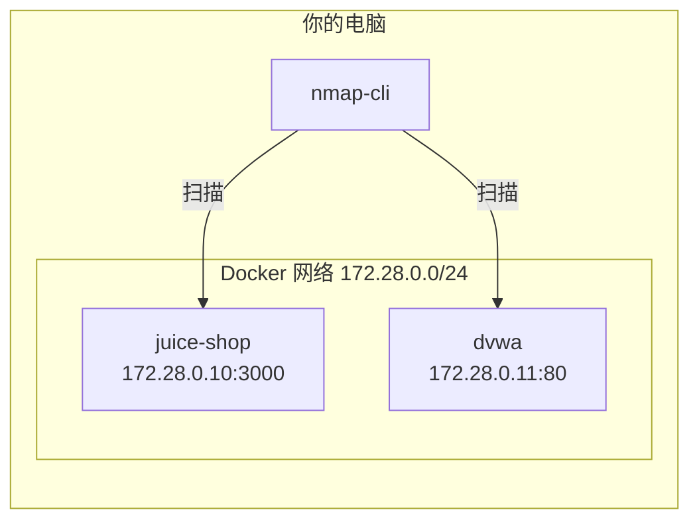

# 实验环境

🌐 [Italiano](../07-lab.md) · [English](../en/07-lab.md) · **中文**

> ⚠️ 本页为机器翻译草稿，正式发布前需母语者校对。

学习需要一个属于你自己的扫描对象。`lab/` 中有一个 `docker-compose.yml`，会在一个隔离网络上启动两个故意留有漏洞的靶机。



这两个应用是专门用来被攻击的公开项目：OWASP Juice Shop 和 DVWA。绝不要把它们暴露到真实网络上，也不要扫描这些地址以外的任何东西。

## 启动

```sh
cd lab
docker compose up -d
```

实验环境的作用域已经准备好，位于 `examples/scope.lab.toml`。日期需要更新：示例中的日期会过期。

```sh
nmap-cli verifica 172.28.0.10 172.28.0.11 --scope examples/scope.lab.toml
nmap-cli scansiona rapido 172.28.0.10 --scope examples/scope.lab.toml
nmap-cli scansiona servizi 172.28.0.10 172.28.0.11 --scope examples/scope.lab.toml --esegui
```

试一条注定失败的命令，看看退出码 3：

```sh
nmap-cli scansiona rapido 172.28.0.10 8.8.8.8 --scope examples/scope.lab.toml; echo $?
```

## 练习

1. 对比 `rapido` 和 `tcp-completo` 在 Juice Shop 上的输出。找出前者没发现的端口（如果有的话）。
2. 把 `172.28.0.11` 加入 `esclude`，然后同时对两个目标重新运行。会发生什么？为什么连第一个目标都不会扫描？
3. 把 `valido_fino` 改成一个已过去的日期。你会得到哪个退出码？
4. 打开 `nmap-cli.audit.jsonl`，手动修改中间某一行的一个字母，然后运行 `nmap-cli audit`。
5. 试着传入 `-- -iL liste.txt`，读一读提示信息。

## 清理

```sh
docker compose down
```

## 说明

该 compose 文件并未在所有 Docker 版本上测试过。如果命令失败，请检查镜像是否仍存在于镜像仓库中，以及 `172.28.0.0/24` 网段是否与你电脑上已在使用的网络冲突。
