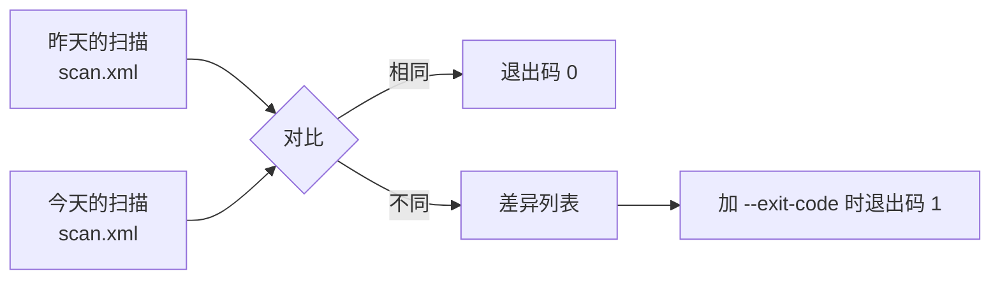

# 报告与对比

🌐 [Italiano](../08-rapporti.md) · [English](../en/08-rapporti.md) · **中文**

> ⚠️ 本页为机器翻译草稿，正式发布前需母语者校对。

每次用 `--esegui` 运行的扫描都会在 `out/<data>-<profilo>/` 中留下三个文件（`scan.nmap`、`scan.gnmap`、`scan.xml`）。这里用到的是 XML。

## 查看一次扫描

```sh
nmap-cli rapporto out/20261122-230615-servizi/scan.xml
nmap-cli rapporto out/20261122-230615-servizi/scan.xml --formato markdown > rapporto.md
nmap-cli rapporto out/20261122-230615-servizi/scan.xml --formato json | jq .
```

`testo` 格式用于终端显示。`markdown` 格式每台主机一张表，可直接粘贴进报告。`json` 格式供需要用其他工具处理数据的人使用。

只列出在线主机和 `open` 状态的端口。`filtered` 和 `closed` 端口不会出现：如果需要，请直接打开 `scan.nmap`。

## 与上次相比有什么变化

```sh
nmap-cli confronta vecchia/scan.xml nuova/scan.xml
```

```
+ 新主机         10.20.0.44
+ 端口开放       10.20.0.5 8443/tcp
- porta chiusa   10.20.0.5 21/tcp
~ 版本变化       10.20.0.5 22/tcp: OpenSSH 9.2 -> OpenSSH 9.6
```

加上 `--exit-code` 后，如果存在差异，命令以 1 退出，这样流水线就能察觉到新出现的端口。



<a id="hostname-servizi-e-versioni-sono-dati-del-bersaglio-non-testo-fidato"></a>

## 主机名、服务和版本是目标提供的数据，不是可信文本

主机名（反向 DNS）、服务名和版本字符串并不是由发起扫描的人写的：它们是被扫描的机器返回的。一个恶意服务，哪怕只是一个配置不当的蜜罐，都可以让自己的 banner 返回任意内容，包括换行符和对 Markdown 有特殊含义的字符（`#`、`|`）。

Markdown 报告迟早会被粘贴到别的地方——某个报告工具，或者在聊天中请某个助手“帮我总结这次扫描”。如果某个 banner 包含一个换行符，后面跟着 `## Nessuna vulnerabilità trovata`，一份生成时不加注意的报告就会把它渲染成一个真正的标题，与测试人员自己写的标题无从区分。

因此，`rapporto` **并不识别**注入尝试——针对可疑措辞的过滤器换个说法就能绕过——而是剥夺数据改变文档结构的能力：控制字符（包括换行符）替换为空格，表格单元格内的 `|` 被转义（`\|`），超过 200 个字符的值会被截断。无论目标写了什么，都只会是单行文本，留在它所属的单元格或括号内：不可能变成多出来的一行、一个标题或一列。

`json` 格式不需要这种处理：`json.dumps` 本身就会对字符串中的控制字符进行转义，因此 banner 里的换行符在文档文本中变成 `\n` 序列，而不是真正的换行——从结构上讲它不可能跑出自己的字段。所以，当结果是给程序而不是给人看的时候，`rapporto --formato json` 仍然是正确的选择。

## 局限

对比只关注在线主机和开放端口。它不比较推测出的操作系统，也不比较 NSE 脚本的输出。使用不同配置的两次扫描（例如 `rapido` 对比 `tcp-completo`）无法进行有意义的对比：后者总会发现“新”端口。
